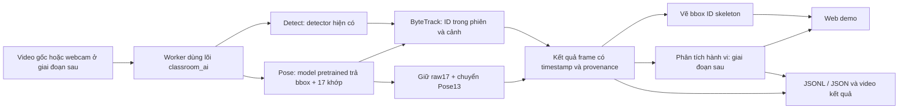

# Kế hoạch demo web thống nhất và gán nhãn hành vi theo thời gian

Ngày: **02/11/2026 — Asia/Saigon**.

> **Mốc triển khai02/11:** người dùng đã yêu cầu dùng Superpowers triển khai/kiểm lỗi toàn bộ theo kế hoạch, ghi riêng phần thiếu dữ liệu/tài nguyên ngay trong file này; sau đó bổ sung refactor tên/cấu trúc và dọn file dư, hướng tới mục tiêu tương lai. Trạng thái hiện hành ở khối dưới và mục14; các số kiểm thử/smoke trong những đợt trước giữ vai trò lịch sử.
>
> **Quyết định triển khai:** web local FastAPI dùng lõi video chung; nhánh `codex/unified-demo-actions`, giữ các thay đổi sẵn có. Giao diện web mới là điểm vào chính; Streamlit được đặt tên rõ là phần tương thích. Không xóa dữ liệu/nhãn/weights hoặc lịch sử nghiên cứu còn giá trị chỉ vì chúng cũ.

> **Đối chiếu hiện hành03/11 — chưa hoàn tất toàn bộ kế hoạch:** nền tảng demo Detect/Pose/ByteTrack, web một điểm vào, timeline, snapshot, consumer local và công cụ đánh giá đã có. Các mở rộng được yêu cầu gồm Intel iGPU, replay nhân quả/đo clock client, ba proxy hành vi cạnh ID, xuất/tự lưu MP4, reviewer độc lập và chuẩn bị nguồn không AI. Đủ8video/17.697frame/78khoảng rà soát ở mục14.10; không còn thiếu năm video nguồn.
>
> Công việc còn mở là GT/coverage/rubric thật, kiểm người/ID trên video giao nhau, hiệu chỉnh và nhận dạng đủ bốn hành vi (viết bảng chưa có), đánh giá riêng Detect/Pose/tracking/hành vi, nguồn test/protocol khóa, camera/tải dài/độ trễ và đối chiếu giảng viên. API đọc lại cả8nhánh group-a vẫn0actor/0event/0coverage, evaluation_ready=false; rubric còn draft. **CMC được người dùng để sang giai đoạn sau.** Các ô phần mềm đã xong không thay nghiệm thu nghiên cứu ở mục11,14.4 và14.6; chưa có metric chất lượng hành vi thật hoặc huấn luyện mới.

**Goal:** Một web local làm điểm truy cập chính cho demo Detect, tracking, Pose và sau đó là hành vi; cùng lõi xử lý và hợp đồng kết quả dùng được cho bot/web khác.

**Architecture:** Web điều khiển một worker xử lý video, dùng lại package `classroom_ai`; không nhúng model vào từng request hoặc xây lại toàn bộ pipeline. Detect và Pose là hai chế độ suy luận; tracking, dựng hình và xuất kết quả dùng chung. Nhận dạng hành vi là giai đoạn sau với nhãn sự kiện theo người và thời gian.

**Tech Stack — đề xuất:** Python hiện có, OpenCV/FFmpeg, Ultralytics, ByteTrack; FastAPI + Uvicorn cho HTTP local, HTML/CSS/JavaScript thuần cho một trang web nhỏ. Model pretrained có sẵn; chưa thêm framework hành vi trong bản demo đầu.

**Spec:** Yêu cầu hội thoại ngày02/11; [mục tiêu chính thức](../plan.md#mục-tiêu-và-yêu-cầu-chính-thức--15102026), [ghi nhớ dự án](../project_memory.md), [hợp đồng Pose13/gán nhãn đã có](../datasets/pose13_annotation_action_plan_20261028.md). Tài liệu này không thay tên đề tài hay nhân bản nội dung chính thức.

## 1. Những gì đã có và phần thực sự còn thiếu

Phần này giữ ảnh chụp kế hoạch trước triển khai02/11. Trạng thái đã kiểm mới nhất ở mục13; đối chiếu đầy đủ mục tiêu chính thức và công việc tháng11 ở mục14, không dùng các ô “còn thiếu” lịch sử dưới đây thay bằng chứng hiện tại.

| Thành phần | Bằng chứng hiện có | Phần còn thiếu cho web demo |
|---|---|---|
| Detect người | `inference/detector.py`, `video/pipeline.py`, LIGHT_CONTRAST và cờ person-only | Giao diện web điều khiển và hỗ trợ checkpoint Detect một lớp person sau này |
| Tracking | `video/tracking.py`, `tracked_processing.py` đã dùng ByteTrack trong full/person-only, có ID/màu và `detection_index` | Truyền khớp Pose đi cùng detection được tracker gán ID; kiểm ID trên video lớp học |
| Pose | Pretrained N/L, thử nghiệm video N và backend ảnh L; mapping COCO17→Pose13 đã có | Adapter trong lõi demo; truyền/vẽ/xuất keypoints cùng bbox/ID; chưa có đường Pose trong video CLI/TUI |
| Kết quả máy đọc | Đã có JSONL detection/track và báo cáo từng run | Hợp đồng thống nhất có version, Pose, sự kiện, trạng thái và provenance |
| Nhãn Thành |807annotation đã lưu; Detect train477ảnh/1.799bbox, val330ảnh/1.387bbox theo quyết định31/10 | Pose13 chưa đủ visibility để xuất train |
| Nhãn Đô |893prediction, chưa có xác nhận duyệt tương ứng trong lần kiểm gần nhất | Duyệt bbox/khớp; chưa được dùng prediction làm GT |
| Hành vi lớp học | Đã có kế hoạch và phạm vi nghiên cứu | Chưa có corpus sự kiện theo thời gian, bộ nhận dạng hành vi hoặc đánh giá định lượng |

**Đính chính:** tracking kèm ID không phải bắt đầu từ số0. Tuy nhiên, hiện chỉ có trong phạm vi full/person-only; không coi fast/webcam hoặc Pose tracking đã được hỗ trợ.

## 2. Phạm vi và nguyên tắc của bản demo thống nhất

- Một địa chỉ web chính, chọn video → chọn chế độ → chạy/dừng → xem video kết quả/tiến trình → tải kết quả.
- Video file là đầu vào giai đoạn1, phù hợp phạm vi video đã duyệt trước đây. Webcam/luồng camera là giai đoạn sau, cần kiểm thiết bị và tốc độ; không coi đã được chọn chỉ vì có chữ “trực tiếp”.
- Một giao diện có đủ các chức năng demo không có nghĩa mọi trách nhiệm phải nằm trong một file hoặc một model.
- Web thuyết minh `docs/project_site/` giữ vai trò giải thích dự án. Label Studio giữ dữ liệu gán bbox/khớp; demo không yêu cầu chạy bộ Label Studio/ML backend cùng lúc.
- Không tự xóa Streamlit/TUI/CLI, đổi launcher gốc hoặc đổi model mặc định cũ. Khi web mới đạt nghiệm thu mới xem xét công cụ nào tiếp tục duy trì.
- Chế độ hành vi chưa triển khai phải được hiển thị rõ; không để một nút trả hành vi giả hoặc gán điểm tương tác tùy ý.
- Bind loopback, xử lý local, không mặc định publish video lên web công khai. Kaggle vẫn Private; tích hợp gửi bot/cloud cần yêu cầu riêng.

## 3. Kiến trúc đề xuất và lựa chọn model

### 3.1. Hai cách làm khả thi

1. **Web mỏng gọi lõi xử lý qua worker — đề xuất chọn:** dùng lại pipeline, detector/tracker/media, nhận tiến độ và kết quả có cấu trúc. Một lần sửa nghiệp vụ dùng được cho web và CLI; cần chuẩn hóa đầu ra và lifecycle.
2. **Web bọc lệnh CLI hiện có:** nhanh cho Detect/tracking ban đầu nhưng khó đồng bộ hợp đồng Pose, hủy job và lỗi nếu chỉ đọc log chữ. Chỉ dùng như bước chuyển tiếp nếu cần demo Detect gấp.

Không xây một pipeline model độc lập trong web song song với pipeline hiện có.

### 3.2. Luồng chạy



- **Detect:** giữ detector hiện có để đối chứng; không tự đổi checkpoint đã thống nhất. Bổ sung hỗ trợ profile Detect một lớp person mà vẫn kiểm chặt tên lớp của các profile khác.
- **Pose:** dùng bbox và keypoint do model Pose trả về; không bắt buộc chạy thêm detector riêng cho cùng frame. Đề xuất N làm ứng viên demo nhẹ, L là tùy chọn đối chứng; chỉ chốt mặc định theo chất lượng và độ trễ đo trên máy demo. L dùng gán nháp hiện tại không tự bị đổi.
- **Tracking:** tái sử dụng ByteTrack. Mang keypoint qua `detection_index` do tracker trả về, không tìm người có khớp gần nhất để gắn ID. Mỗi phiên/cảnh có phạm vi ID; không nhận diện danh tính sinh viên hoặc cam kết ID xuyên suốt cả buổi.
- Không thay detection/Pose raw bằng box làm mượt. Nếu dùng box EMA hoặc nội suy để hiển thị, xuất cờ riêng; không nội suy khớp/hành vi rồi ghi thành quan sát thật.
- Worker suy luận có số lượng giới hạn, tái sử dụng model. Không tạo một thread nạp model/suy luận mới cho từng request; kiểm việc tăng thread/RAM sau nhiều frame, rút kinh nghiệm backend ảnh từng bị đứng.

### 3.3. Giao diện web bản đầu

Một trang, ba khu vực chính:

1. **Nguồn và điều khiển:** chọn file local, chế độ Detect/Pose, bật ID, chọn model có sẵn và thiết bị; bắt đầu/hủy. Không đưa các tùy chọn nghiên cứu chưa dùng vào màn hình đầu.
2. **Video và tiến độ:** phân biệt đang nạp model, xử lý, dựng video, hoàn tất/lỗi/hủy; xem bbox/ID/skeleton qua các lớp bật tắt. Tua kết quả đã xuất không suy luận lại. Không coi FPS phát video là FPS xử lý AI.
3. **Kết quả:** số liệu hiệu năng, đoạn có bằng chứng, tải JSON/JSONL/video; hành vi và tổng hợp lớp được bổ sung sau khi có cơ chế nhận dạng đã kiểm chứng.

Không gọi một video đã xử lý trước là demo suy luận thời gian thực. Nếu CPU không đạt tốc độ mong muốn, trình bày đúng chế độ xử lý rồi phát kết quả.

## 4. Pose17, Pose13 và nhãn hành vi là ba khái niệm khác nhau

- **17** là số loại khớp COCO, không phải17 hành vi. **13** là một điểm đầu cộng12 khớp cơ thể của dự án, không phải13 hành vi.
- Giữ raw17 và confidence để truy vết; chuyển sang13 bằng mapping đã quy định. Phần đầu gộp từ các điểm mặt chỉ là ước lượng tâm đầu, vẫn có thể sai.
- Điểm hiển thị có confidence>=0,05 được giữ dù chồng nhau; cạnh chỉ nối hai điểm còn tồn tại của cùng người. Ngưỡng điểm không phải ngưỡng bbox và không phải nhãn visibility.
- Mỗi điểm có thể thiếu do che khuất/khó quan sát. Không ép đủ13 điểm và không gán visibility nhìn thấy cho điểm không nhìn thấy.
- Fine-tune Pose13 là nhánh tùy chọn khi đánh giá cho thấy cần cải thiện khớp. Không cần hoàn tất nhãn khớp thủ công cho mọi ảnh để bắt đầu thử nhận dạng hành vi từ model Pose pretrained, nhưng dữ liệu hành vi dùng đánh giá vẫn phải có GT được duyệt.
- Nếu dùng model hành vi pretrained cho skeleton17, phải giữ đúng số điểm/thứ tự/đồ thị/chuẩn hóa mà model đó yêu cầu. Không đưa13 điểm vào checkpoint17, không bịa5 điểm mặt để “đủ số”. Có thể dùng raw17 được giữ hoặc thiết kế/train model13 riêng sau này.

## 5. Chuỗi thời gian: dùng video gốc và manifest, không chỉ ảnh rời

**Nguồn chuẩn là video gốc.** Các MOV của Thành và Đô vẫn được giữ; những video mới chưa được kiểm đầy đủ thì không coi đã thu/tách xong.

- Ảnh10FPS phục vụ sửa bbox/khớp, xem ảnh đại diện và ghép nhãn theo frame. Manifest đã có source frame index, PTS, time_base, timestamp và hash để truy về video.
- Chuỗi dùng cho hành vi cần người/track được liên kết qua nhiều frame, thứ tự và timestamp thật, trạng thái điểm thiếu và ranh giới cảnh. Project ảnh hiện tại không tự có track ID liên tục chỉ vì ảnh xếp cạnh nhau.
- Có thể xây chuỗi10FPS từ manifest hoặc chạy lại Pose/tracking trên video gốc khi được phép. Không đồng nhất “10FPS lấy mẫu để gán ảnh” với cấu hình tối ưu cho nhận dạng mọi động tác.
- Khi xem hành vi, phát video gốc; xem chậm hoặc frame trước/sau khi cần. Động tác nhanh có thể cần kiểm frame nguồn dày hơn; giữ bất định nếu không xác định được.
- Dùng thời gian theo PTS, không suy timestamp bằng index/30. Phân biệt thời gian frame nguồn, thời gian relative và mốc lấy mẫu mục tiêu. FPS nguồn và FPS xử lý là hai đại lượng khác nhau.
- Nhãn hành vi lưu khoảng `[start_s,end_s)`. Có cờ bắt đầu trước clip/kết thúc sau clip khi sự kiện bị cắt ở đầu/cuối; không giả vờ quan sát được phần ngoài video.

## 6. Bộ nhãn và các trường hợp đồng thời

### 6.1. Các lớp thông tin độc lập

| Lớp thông tin | Giá trị/nhãn đề xuất | Quy tắc |
|---|---|---|
| Đối tượng | person + bbox | Không đổi person thành đứng/ngồi để thay nhãn Pose |
| Khớp | Pose17 raw, Pose13 hiển thị/duyệt | Tọa độ/confidence/visibility là thông tin khác nhau |
| Trạng thái tư thế hỗ trợ | sitting, standing, transition, unknown | Một trạng thái chính cho một người tại một thời điểm; tư thế ngoài phạm vi để unknown và ghi lý do |
| Sự kiện/hành vi | raise_hand, stand_up, move_to_board, write_board | Các hành vi chính thức; cho phép nhiều nhãn cùng lúc |
| Chất lượng/độ chắc chắn | visible, partial, insufficient; reviewed/unreviewed/disputed | Phân biệt quan sát được, chưa xem và không thể kết luận |

Đứng/ngồi là trạng thái hỗ trợ, không thay đổi danh mục nghiên cứu chính thức. “Đứng lên” là sự kiện chuyển trạng thái. Nếu bổ sung “ngồi xuống” làm lớp đích huấn luyện, cần quyết định riêng.

### 6.2. Ví dụ một người vừa đứng vừa giơ tay

Ví dụ minh họa, không phải annotation đã có:

- Tư thế `standing` từ10đến18giây.
- Sự kiện `raise_hand` từ12đến15giây, cùng actor/track.
- Hiển thị “Đứng · Giơ tay”. Không tạo lớp ghép `standing_and_raise_hand`.
- Một lần giơ tay kéo dài qua nhiều frame chỉ tính một episode sau khi đã có quy tắc đóng/mở sự kiện; không cộng một lần cho mỗi frame.
- `sitting` và `standing` không cùng được xác nhận cho cùng người cùng thời điểm. `raise_hand` có thể đi cùng một trong hai.

### 6.3. Rubric gán sự kiện ban đầu

| Nhãn | Bắt đầu/kết thúc cần xác định | Âm khó hoặc trường hợp không đủ bằng chứng |
|---|---|---|
| raise_hand | Bắt đầu khi hành vi giơ tay có bằng chứng trong diễn tiến; kết thúc khi tay hạ hoặc không còn quan sát được; đánh dấu ranh giới chưa chắc nếu cần | Chạm đầu, vươn vai, cầm đồ, tay bị che; không dùng một điều kiện cổ tay cao hơn vai trên1frame để chốt |
| stand_up | Bắt đầu đoạn rời tư thế ngồi, kết thúc khi đứng ổn định; không gán chỉ vì frame cuối có người đứng | Chồm người, đứng sẵn từ trước clip, hông/chân bị che |
| move_to_board | Di chuyển có quỹ đạo tới vùng bảng định nghĩa theo camera; ghi lúc bắt đầu di chuyển và kết thúc đến vùng đích theo rubric | Đi ngang bảng, đứng cạnh bảng từ trước, mất ID giữa đường |
| write_board | Đứng ở bảng và có bằng chứng thao tác viết; ranh giới theo thao tác quan sát được | Chỉ bảng, lau bảng, đứng nhìn bảng; dùng hình ảnh crop/ngữ cảnh nếu Pose không phân biệt được |

Khoảng thời gian tối thiểu, hysteresis và dung sai ranh giới là tham số cần chốt bằng pilot/dev. Không tự đặt chúng thành chân lý cho mọi lớp học hoặc điều chỉnh bằng tập test.

## 7. Trường hợp khó, ngoại lệ và dữ liệu không chắc chắn

| Trường hợp | Xử lý nhãn/hiển thị | Điều không được suy ra |
|---|---|---|
| Mờ, người nhỏ, bàn che tay/chân | Gán phần có bằng chứng; đánh dấu điểm thiếu và hành vi unknown nếu không kết luận được | Không lấy confidence cao hoặc ảnh AI tăng nét làm GT |
| Model bỏ sót người | Người duyệt bổ sung bbox/actor khi thấy rõ; giữ lỗi model cho đánh giá | “Không có detection” không có nghĩa ảnh không có người |
| Khớp sai/chồng nhau | Giữ raw để truy vết, sửa điểm có thể xác định; quan hệ cùng người | Không tự xóa một điểm chỉ vì gần điểm khác |
| Track đổi ID, hai người giao nhau | Đánh dấu đoạn đứt/ID switch; người duyệt chỉ nối đoạn khi có bằng chứng; tách sự kiện nếu chưa chắc | Không nối theo khoảng cách gần nhất hoặc suy danh tính |
| Vào/ra khung, cắt cảnh | Mở đoạn mới, ghi coverage và ranh giới bị cắt; reset bộ nhớ hành vi theo cảnh | Không tính phần thời gian không quan sát được thành quan sát thật |
| Một người nhiều hành vi | Nhiều event interval cùng actor; posture riêng | Không ép mỗi frame chỉ có một nhãn tổng hợp |
| Không thấy hành vi sau khi đã xem đầy đủ | Ghi âm đã duyệt cho đúng hành vi và khoảng thời gian quan sát | unknown hoặc chưa xem không phải negative |
| Hành động ngoài bộ nhãn | Ghi ghi chú/ngoài phạm vi, giữ để xem xét sau | Không ép vào lớp gần giống hoặc suy mức tương tác |
| Sự kiện ngắn/động tác nhanh | Kiểm video gốc và PTS, giữ uncertainty nếu ranh giới không rõ | Không tự nội suy hành động từ hai ảnh rời |

Không diễn giải cúi đầu là ngủ; không coi một cử chỉ là mức độ năng nổ. Tổng hợp phục vụ giảng viên theo khoảng thời gian và cả lớp, không lập hồ sơ đánh giá từng sinh viên.

## 8. Kế hoạch gán hành vi khi dữ liệu mới sẵn sàng

### Giai đoạn chuẩn bị — không cần chờ đủ số ảnh để viết rubric

- Chốt định nghĩa nhãn, cách đánh dấu unknown và khoảng thời gian; chọn một số đoạn đã có để pilot nếu người dùng yêu cầu. Chưa tự chạy pilot trong lượt này.
- Kiểm metadata nguồn quay: video gốc, ai quay, buổi/camera/cảnh và video ngắn có cắt từ video dài không. Ước lượng5.900ảnh không phải cam kết đã đủ mẫu dương cho cả4hành vi.
- Không chốt split5.900ảnh chỉ theo số lượng. Phương án70/15/15 đã bàn chỉ là đề xuất; video/đoạn cùng nguồn quay cần cùng nhóm.

### Khi có đủ đầu vào dự kiến

1. Kiểm video gốc và hash; tách ảnh/giữ manifest mới theo quy trình đã dùng. Không trộn ảnh cũ/mới và không tính ảnh trùng là mẫu độc lập.
2. Duyệt bbox và các lỗi khớp có ảnh hưởng. Lưu phạm vi duyệt bbox, Pose và hành vi riêng; Submit ảnh không tự chứng minh cả ba đã đúng.
3. Chạy Pose/tracking trên chuỗi khi được yêu cầu; tạo gợi ý actor và đoạn sự kiện. Prediction vẫn là gợi ý.
4. **Pilot khoảng5–10đoạn thực có nội dung cần gán**, chọn cả mẫu dễ, âm khó và che khuất. Con số này chỉ để thử rubric/công cụ; không cam kết đủ huấn luyện. Nếu một hành vi không có mẫu dương, ghi thiếu và đề nghị quay bổ sung thay vì tạo nhãn giả.
5. Người gán xem video gốc, chọn actor và kéo khoảng thời gian; gán posture và nhiều hành vi song song. Không yêu cầu kéo lại13khớp ở mọi frame để đặt một nhãn sự kiện.
6. Hai người gán độc lập một phần pilot rồi đối chiếu actor/nhãn/ranh giới. Đo thời gian sửa trên dữ liệu thật và các kiểu bất đồng; cập nhật rubric trước khi gán phần còn lại.
7. Gán toàn bộ các khoảng video được chọn, gồm cả khoảng âm và coverage; không chỉ lấy những đoạn AI đã phát hiện thành công. Lưu người duyệt, phiên bản rubric và lý do bất định.
8. Kiểm overlap hợp lệ, nhãn mâu thuẫn, thời gian ngoài clip, actor không tồn tại, cảnh bị đứt và nguồn train/dev/test. Xuất snapshot GT được duyệt và khóa split trước tuning.

**Độ khó:** thao tác gán một khoảng hành vi thường ít điểm kéo hơn gán13khớp trên từng frame, nhưng khó ở xác định đúng người, diễn tiến, ranh giới và các động tác gần giống. Chi phí phụ thuộc số sự kiện, số actor và mức che khuất; không thể suy thời gian gán chỉ từ5.900ảnh.

**Công cụ:** tiếp tục LabelStudio cho bbox/khớp đã có. Đề xuất một khu vực “Duyệt hành vi” trong web thống nhất ở giai đoạn sau, có video gốc + timeline theo actor + nhãn chồng lấp + unknown + lưu nháp/duyệt. Trước khi xây cần thử một fixture nhiều hành vi/cùng người; không hứa màn hình gán ảnh hiện tại đã làm được timeline này. Không xây lại công cụ kéo bbox/keypoint đầy đủ trong web demo đầu.

## 9. Hợp đồng đầu ra dùng cho web/bot/hệ sinh thái

JSON schema dưới đây là **đề xuất version mới**, không ghi đè JSONL lịch sử. Dùng cùng schema cho web và CLI; bot/web khác đọc kết quả hoặc API, không phụ thuộc widget.

| Tệp | Nội dung |
|---|---|
| `manifest.json` | schema_version, run_id, source_video_hash, chiều ảnh, nguồn thời gian, model/config/version, trạng thái job và phạm vi xử lý |
| `frames.jsonl` | source_frame_index, source_pts, time_base, timestamp_s; danh sách người có bbox gốc, track_id, raw17, pose13, mask điểm thiếu, confidence và cờ nội suy/quan sát |
| `events.jsonl` | event_id, video/scene, actor_track_id, label, start_s,end_s, prediction/review status, evidence frame range, uncertainty và provenance |
| `summary.json` | Số frame/người/sự kiện, thời lượng theo nhãn và cửa sổ lớp, thời gian xử lý, p50/p95, tài nguyên, cảnh báo chất lượng và coverage |
| `annotated.mp4` | Video xem kết quả, tùy chọn; giữ video gốc riêng |

Các quy tắc bắt buộc:

- Bbox theo pixel ảnh gốc, origin góc trái trên; khai báo rõ thứ tự xyxy và kích thước ảnh. Keypoint theo pixel gốc; điểm thiếu dùng null/mask tường minh, không nhầm với tọa độ góc ảnh.
- TrackID có phạm vi run/video/scene; không dùng một số ID để liên kết danh tính giữa các lượt.
- Confidence mô hình, visibility GT và trạng thái duyệt là ba trường riêng. Nhãn người sửa không âm thầm được ghi đè bởi dự đoán chạy lại.
- Giữ riêng kết quả dự đoán và annotation GT. Bot chỉ được báo phần nào là quan sát/gợi ý/không chắc; summary không tự biến thành điểm đánh giá sinh viên.
- Sự kiện nhiều nhãn có thể overlap; một interval dùng cho một label hoặc một mảng label được định nghĩa nhất quán. Đề xuất một interval/một label để dễ sửa và thống kê.
- Khi mất quan sát, ghi unknown coverage; không cộng trùng thời gian trong tổng hợp hoặc gộp các ID chưa xác nhận là một người.
- Run bị hủy/lỗi giữ trạng thái và số frame thực có kết quả; không trả complete chỉ vì web còn truy cập được.
- Bản demo chỉ tải file/đọc API local; chưa tự gửi dữ liệu cho bot, tạo webhook hoặc cấp tài khoản ngoài.

Ví dụ sự kiện minh họa:

```json
{
  "segment_id": 0,
  "track_id": 7,
  "label": "raise_hand",
  "start_s": 12.0,
  "end_s": 15.0,
  "origin": "human",
  "review": "reviewed",
  "uncertain": false,
  "evidence": {"note": "Ví dụ minh họa", "boundary_truncated": {"start": false, "end": false}}
}
```

Đây chỉ là ví dụ schema, không phải GT đã ghi vào dataset. `schema_version`, run và hash nguồn nằm trong bundle/manifest; actor là cặp `segment_id, track_id`. `count` tổng hợp chỉ đếm onset quan sát được; episode đã có từ đầu clip/coverage không tự tính là một lần bắt đầu mới. Thời lượng là thời lượng quan sát trong đoạn, không suy phần trước/sau clip.

## 10. Lộ trình triển khai đề xuất, mỗi bước có đầu ra kiểm được

Đường dẫn bên dưới tính từ gốc repository. Không tạo trước tất cả file; chỉ thêm khi đến phần cần thực hiện.

### Bước1 — Hợp đồng kết quả và profile model

**Sửa:** `src/classroom_ai/video/core.py`, `src/classroom_ai/inference/detector.py`; **test:** `tests/unit/test_video_core.py`, `tests/integration/test_video_pipeline.py`.

- [x] Thêm cấu hình `analysis_task: detect | pose`, schema2 và dữ liệu frame; giữ mặc định Detect cũ.
- [x] Profile Detect person1 chính xác; guard COCO80/project8 và task Detect/Pose vẫn hoạt động.
- [x] Test VFR/missing/null/profile sai; raw Pose không tự thành nhãn visibility.
- [x] Pipeline cũ qua hồi quy; không chạy train.

### Bước2 — Pose pretrained + tracking cùng người

**Tạo khi triển khai:** `src/classroom_ai/inference/pose.py`, `tests/unit/test_pose_inference.py`; **sửa:** `video/pipeline.py`, `video/tracked_processing.py`, `video/rendering.py`, `video/__main__.py`, `video/core.py`.

**Interface đề xuất:** `PoseInspector.predict(frame, confidence, *, imgsz, extra_nms_iou=None, passes=1) -> dict`, trả danh sách detection có bbox/class/confidence, `keypoints17`, `keypoints13` và mask; kiểm tham số không hỗ trợ thay vì im lặng bỏ qua.

- [x] Test fixture17→13, head fallback, ngưỡng0,05/điểm chồng, thứ tự, missing và cạnh cùng người.
- [x] Adapter độc lập khớp quy ước13 hiện hành; có test đối chiếu LabelStudio, không import runtime hoặc sửa gói chuyển máy.
- [x] Truyền keypoint theo `detection_index` của ByteTrack; fixture hai người giao nhau, detection/track đổi thứ tự, person filtering và mất quan sát giữ đúng raw17/raw13/missing của detection được tracker trả về. Hai hồi quy trong `PoseAssociationContractTests` kiểm hợp đồng adapter bằng đầu ra tracker xác định trước, từ chối ghép Pose theo thứ tự danh sách hoặc box gần nhất. Kiểm mới cả file tracking cùng test raw Pose pipeline:22qua/12,51s; không suy đây là IDF1 hoặc kiểm danh tính thật ở Bước4.
- [x] Raw và display riêng; interpolation chỉ có box/cờ/provenance, không tạo khớp/GT.
- [x] CLI hỗ trợ Pose; web là điểm vào chính, launcher/entrypoint đã refactor.
- [x] Kiểm một clip ngắn Đô60frame có provenance, video/JSON/PTS, CPU và đối chiếu web–CLI. GPU/soak và chất lượng GT vẫn để riêng; không benchmark dài.

### Bước3 — Web local điều khiển cùng worker

**Đường dẫn hiện hành sau refactor:** `src/classroom_ai/interfaces/web.py`, `src/classroom_ai/interfaces/web.html`, `requirements/web.txt`, `tests/integration/test_web_workspace.py`. Streamlit cũ ở `interfaces/streamlit_ui/`; `run_demo.cmd` gọi web mới. Không giữ hai bản pipeline suy luận.

**Interface HTTP đề xuất:** `POST /api/jobs`, `GET /api/jobs/{job_id}`, `POST /api/jobs/{job_id}/cancel`, `GET /api/jobs/{job_id}/artifacts/{name}`. Job chỉ tham chiếu tài nguyên thuộc workspace/run đã kiểm, không nhận tùy ý đường dẫn hệ thống từ client ngoài.

- [x] Test lifecycle, lỗi/hủy/partial và cạnh tranh trạng thái; không suy complete từ health.
- [x] Một worker/cache model, một job active; registry tối đa20, không evict worker đang chạy.
- [x] UI chọn video/Detect/Pose/ID/chạy/hủy/tiến độ/xem/tải; kiểm trên trình duyệt thật.
- [x] Test nguồn/codec/weights lỗi, hai job, hủy ở probe/mux/validation, snapshot cũ và artifact traversal Windows.
- [x] Cùng clip/cấu hình web–CLI tương đương60/60frame, gồm raw bbox/khớp/ID/PTS; đã lưu báo cáo, không coi là realtime.
- [x] Dùng launcher `run_demo.cmd` hiện có cho web; Streamlit chuyển `streamlit_ui`, giữ công cụ cũ. Chỉ bind127.0.0.1.

### Bước4 — Timeline nhãn hành vi và snapshot GT

**Sửa:** hai file web ở bước3; **tạo khi cần:** `src/classroom_ai/video/actions.py`, `tests/unit/test_action_annotations.py`.

**Interfaces đề xuất:** `validate_events(events, *, duration_s, track_segments, coverage) -> list[dict]`; `save_reviewed_events(events, destination) -> Path`. Chỉ ghi snapshot mới, không sửa/export đè dữ liệu ảnh cũ.

- [x] Test đứng+giơtay hợp lệ, mâu thuẫn posture bị từ chối, unreviewed không thành negative, interval ngoài clip không hợp lệ.
- [x] Timeline theo nguồn/actor/đoạn quan sát, posture/action riêng, unknown/uncertain/evidence/ranh giới, nháp/duyệt và snapshot atomic không overwrite.
- [ ] Kiểm PTS/manifest và một clip có hai người đổi chỗ; người duyệt kiểm danh tính cục bộ trước gán hành vi.
- [ ] Chạy pilot rubric rồi mới gán đầy đủ nguồn mới; thống kê công sức, bất đồng và số episode thực tế từng lớp.

### Bước5 — Baseline hành vi, đánh giá và tổng hợp lớp

**Sửa:** `video/actions.py`, `video/pipeline.py`, web demo; **test:** `tests/unit/test_action_annotations.py`, `tests/integration/test_video_pipeline.py`.

- [x] Có baseline giơ tay opt-in theo thời gian/dwell/hysteresis, reset khi thiếu dữ liệu/cắt cảnh/ID không chắc. Chỉ tạo rule/draft; không khẳng định luật đủ tốt hoặc tự nhận đủ bốn hành vi.
- [ ] Chọn ngưỡng trên dev, ghi lại phiên bản, khóa test. Kiểm âm khó: chạm đầu/vươn vai/đi ngang bảng; không tự coi tất cả là raise_hand hoặc move_to_board.
- [x] Test một episode kéo dài, reset khi mất cảnh/quan sát/ID không chắc; episode trái bị cắt không cộng onset mới.
- [ ] Đánh giá precision/recall/F1 từng hành vi, event matching theo temporal IoU và dung sai ranh giới đã chốt, sai số đếm/thời lượng; báo cả unknown/coverage và lỗi tracking.
- [x] Có tổng hợp cửa sổ/cả buổi cấp lớp, onset/thời lượng/coverage/uncertainty; chưa có phân mức/điểm tự đặt. Chất lượng thực nghiệm vẫn cần GT/giảng viên.
- [ ] Chỉ cân nhắc model chuỗi sau khi có GT, số episode và lỗi baseline. Chọn raw17 hoặc schema13 đúng với kiến trúc; không mặc định train ST-GCN/PoseC3D ngay.

### Bước6 — Webcam và tích hợp hệ sinh thái

- [ ] Sau khi video demo đạt yêu cầu, kiểm webcam cụ thể; dùng cùng hợp đồng frame/event, timestamp nguồn và bộ đệm có giới hạn.
- [ ] Đo độ trễ xử lý p50/p95, tốc độ xử lý, FPS phát, cold start và tài nguyên riêng. Mục tiêu dưới3giây vẫn là mục tiêu cần chứng minh; độ dài lịch sử hành vi có thể dài hơn3giây.
- [x] Consumer kỹ thuật đọc JSON/JSONL schema2, đối chiếu source/model/hash/frame qua web–CLI; partial/restart có test.
- [ ] Consumer bot/web đích cụ thể và chính sách khi gặp schema mới: cần đích tích hợp/đặc tả trước; chưa gửi ngoài.

## 11. Điều kiện nghiệm thu và việc còn phải quyết định

### Nghiệm thu chức năng

- [x] Web một điểm vào Detect/tracking/Pose, không cần LabelStudio8080/ML9090.
- [x] Liên kết bbox/ID/khớp/frame/PTS được kiểm; toggle/seek không suy luận lại. Đây không phải bằng chứng IDF1/Recall trên lớp thật.
- [x] Raw17/Pose13/missing/visibility/confidence tách bạch,13khớp không phải13hành vi.
- [x] Consumer đọc lại JSON/JSONL/version, phân biệt lỗi/hủy/partial; web–CLI khớp.
- [x] Pipeline cũ qua hồi quy, nguồn/nhãn/weights giữ nguyên.
- [x] Có fixture kỹ thuật đa nhãn/unknown/ID/gap/cut/VFR/khớp thiếu và confidence thấp. Chất lượng trên ảnh mờ thật còn cần GT như bảng thiếu dữ liệu.

### Nghiệm thu chất lượng nghiên cứu

- Chốt tập kiểm và rubric trước khi chạy; báo phạm vi camera/buổi/người có trong test.
- Kiểm riêng lỗi Detect, Pose, tracking và hành vi; không dùng một metric bbox để kết luận nhận dạng hành vi tốt.
- Ngưỡng chấp nhận F1/IDF1/sai số thời lượng cần chốt sau pilot và trước test cuối; tài liệu này không bịa mức chính xác bảo đảm.
- Số5.900ảnh là dự kiến theo thời lượng video đã trao đổi. Chưa có đủ đầu vào và nhãn thì không coi corpus hành vi sẵn sàng chỉ vì phép tính số ảnh đạt mục tiêu.

### Những lựa chọn đã chốt và đầu vào còn thiếu

1. Người dùng đã yêu cầu triển khai web mỏng local + worker làm hướng chính, video file trước; webcam vẫn ở bước6.
2. Chọn model Pose mặc định sau pilot N/L; giữ L gán nhãn hiện hành trong lúc chưa có quyết định mới.
3. Duyệt rubric trạng thái/hành vi/unknown và nơi gán timeline; xác nhận các video mới/đoạn ngắn có cùng nguồn hay không.
4. Chốt tiêu chí hiệu năng trên máy demo và tiêu chí chất lượng trên tập test sau pilot.

## 12. Nguồn đối chiếu

- [Mã ByteTrack trong dự án](../../src/classroom_ai/video/tracking.py), [xử lý full tracking](../../src/classroom_ai/video/tracked_processing.py): có `track_id` và `detection_index` để giữ quan hệ người–detection.
- [Cấu trúc dự án hiện hành](../../docs/architecture/project_structure.md): dùng chung lõi, ưu tiên ít file, model/tracker không sở hữu widget.
- [Ultralytics Pose](https://docs.ultralytics.com/tasks/pose/): Pose trả bbox và keypoints; các điểm không phải nhãn hành vi.
- [Ultralytics Track](https://docs.ultralytics.com/modes/track/): tracking hỗ trợ Detect và Pose; cấu hình tracker phải chọn tường minh khi muốn ByteTrack.
- [MMAction2 — chuẩn bị dữ liệu](https://mmaction2.readthedocs.io/en/dev-1.x/user_guides/prepare_dataset.html): skeleton action recognition dùng chuỗi keypoints và nhãn hành động; không thay nhãn sự kiện bằng nhãn khớp.
- [Ultralytics — rò rỉ dữ liệu](https://www.ultralytics.com/glossary/data-leakage): giữ mẫu cùng nguồn video/cảnh trong cùng split và khóa test.

## 13. Thực hiện, kiểm chứng và phần phải để riêng

### Đang nghiệm thu kỹ thuật

- Đã có web canonical, CLI/Pose, tracker giữ liên kết detection–khớp; nguồn/frames/events/summary version2, PTS thực, raw17/Pose13 và missing mask. VFR dùng PyAV16.1.0, không âm thầm chuyển nguồn sang nhịp cố định. Native OpenCV VFR seek chưa hỗ trợ; dùng web hoặc CLI headless.
- Đã có timeline đa nhãn, coverage độc lập, nháp/duyệt, snapshot; luật giơ tay theo thời gian chỉ là gợi ý chưa hiệu chỉnh. Đếm onset phân biệt đoạn bị cắt, không lấy episode đã có ở đầu clip làm một lần mới.
- Toàn bộ244test đã qua trước vòng sửa cuối (103,43giây,1cảnh báo deprecation của Starlette TestClient). Kiểm ngoài sandbox vì Windows sandbox chặn socketpair của asyncio; môi trường kiểm riêng có augmentation, không cài OpenCV headless đè môi trường chạy chính. Đây là mốc hồi quy, chưa thay nghiệm thu các lỗi review cuối.
- Rà soát độc lập phát hiện các lỗi tích hợp tải artifact, PTS/hình học preview, cạnh tranh hủy/hoàn tất, chọn đoạn actor, provenance/ranh giới, ghi snapshot và giới hạn cache. Đang sửa bằng ca hồi quy cụ thể trước bàn giao; không lấy244test xanh để bỏ qua các lỗi này.
- Smoke Pose pretrained trên frame đầu Đô: N640/conf0,25 trả0box; N1280/conf0,05 trả4box; L1280/conf0,25 trả1box. Đây là đầu ra một ảnh, không phải Recall hay quyết định model tốt nhất. Người ở xa nhỏ nên cấu hình/model cần pilot có GT.
- Web N1280/conf0,05 + ByteTrack đã xử lý60/60frame của clip kiểm2giây trích từ giây10 của Đô. Pipeline46,02giây, inference callback khoảng1,77FPS; không phải demo realtime30FPS và chưa đạt nghiệm thu end-to-end dưới3giây. Clip kiểm nằm dưới `runs/demo/`, không nhập Label Studio, không tạo GT hoặc đổi split.
- Refactor giữ lịch sử, source video, nhãn, model; kiểm đủ903target/hash lịch sử, có xử lý đường dẫn Windows dài. Dọn10file metadata/log pip đã xác minh ở gốc (272.644byte); không coi mọi thứ trong `.temp` hoặc file cũ là rác.
- Bổ sung ignore cho video nguồn và state chuyển máy/backend riêng tư đang nằm ở gốc, giữ bytes để tránh đưa nhầm vào commit. Đã đưa các hồi quy JavaScript có giá trị vào `tests/frontend/`, không để chỉ tồn tại trong scratch.

### Thiếu dữ liệu, thiết bị hoặc quyết định để nghiệm thu nghiên cứu

| Việc để riêng | Điều còn thiếu | Cách đi tiếp / điều kiện mở lại |
|---|---|---|
| Corpus hành vi theo video (ước tính5.900ảnh ở kế hoạch cũ) | Đã có8video/17.697frame gốc/78khoảng rà soát; chưa có corpus episode/coverage được nhóm duyệt và chưa xác nhận quan hệ buổi/camera/đoạn cắt | Bắt đầu sáu khoảng pilot Thành rồi mở rộng các nguồn mới; gán/duyệt trước khi tuning, kiểm source-group và khóa split/protocol trước đánh giá. Không suy số episode từ số ảnh |
| GT Đô/Pose13 | Export hiện có của Đô chứa893annotation và893prediction; cả893result annotation trùng prediction, chưa chứng minh từng ảnh đã được người duyệt kiểm. Cả54.892keypoint trong export Thành/Đô thiếu trường explicitvisibility | Người duyệt kiểm bbox/khớp/visibility theo phạm vi; không dùng trạng thái Submit hoặc confidence làm chứng nhận GT Pose. Việc này không chặn gán hành vi trực tiếp trên video |
| GT sự kiện theo thời gian | Người dùng đã chọn pilot5–10đoạn từ Thành, nhóm người dùng duyệt; chưa có GT/coverage âm/ranh giới hoặc thống kê bất đồng | Đã chuẩn bị6khoảng cùng nguồn train trong manifest dưới đây; rà một phần độc lập bởi hai người, thống kê episode và âm khó |
| Nhận dạng hành vi tự động đủ phạm vi | Đợt14.8 có ba proxy giơ tay/đứng lên/đến vùng sàn trước bảng; chưa hiệu chỉnh, chưa có dev/GT/rubric được duyệt; chưa có nhận dạng viết bảng | Gán timeline/RGB/board context thật, đo và hiệu chỉnh baseline bốn hành vi trên dev; không coi proxy nháp hoặc Pose đơn lẻ là chứng minh viết bảng |
| Hiệu chỉnh luật giơ tay | Chưa có tập dev/test hành vi khóa, ngưỡng/dung sai biên/tIoU chưa chốt | Dùng đề xuất nháp để rà; chọn ngưỡng trên dev, chốt trước test cuối |
| Đánh giá riêng Detect/Pose/tracking | Chưa có báo cáo chất lượng trên GT video đích; evaluator sự kiện hiện có không tự cung cấp Recall bbox, chất lượng khớp hoặc IDF1. Nhãn actor/reference phục vụ timeline không thay bộ bbox/khớp/ID GT theo frame | Chuẩn bị GT phù hợp cho từng phép đo và nối công cụ đánh giá tái lập; tách lỗi phát hiện, khớp, ID và hành vi theo điều kiện nghiệm thu mục11 |
| Pose N/L và webcam/GPU | Đã đo N1280/iGPU Intel, clip full60frame và replay Thành47,65giây với độ trễ server/DOMcommit tách riêng ở mục14.5; chưa kiểm L/camera/máy khác hoặc tải dài | Chọn video/camera/phần cứng và tiêu chí; đo p50/p95, cold start, hiệu năng tải dài; không suy nghiệm thu lớp học từ lượt ngắn |
| Train model chuỗi/Pose13 | Chưa đủ GT/episode/schema/kiến trúc đã chọn | Giữ raw17 cho model17; chỉ train sau audit nguồn/split và baseline, không bịa điểm mặt hoặc nhãn hành vi |
| Chỉ số tương tác và đánh giá giảng viên | Chưa có rubric/tiêu chí phân mức và đánh giá lớp thực tế | Chốt cùng giảng viên; hiện chỉ xuất số đếm/thời lượng/coverage cấp lớp, không tự đặt điểm |
| Bot/cloud và demo dài | Chưa có đích tích hợp/quyền gửi dữ liệu, clip soak hoặc tiêu chí nghiệm thu | Consumer đọc file/API local trước; thêm gửi ngoài/camera sau yêu cầu cụ thể |

Các mục thiếu ở bảng này giữ trạng thái chưa nghiệm thu. Việc phần mềm chạy và xuất JSON không chứng minh độ chính xác hành vi, IDF1, độ trễ lớp học hoặc tính tương tác.

### Kết quả nghiệm thu kỹ thuật cuối —03/11/2026

- Python toàn dự án: **272passed,1skipped,1warning** trong137,65giây, dùng môi trường kiểm riêng có augmentation. Skip do thiếu quyền tạo symlink cuối file trên Windows; encoded-backslash traversal đã được kiểm thật và bị chặn. Warning là deprecation Starlette TestClient, không phải lỗi xử lý video.
- Frontend: **16/16Node built-in tests** tại `tests/frontend/`, gồm actor nhiều extent, điểm biên phân số, originrule khi review, ranh giới bị cắt, clockmicrogiây, legacy preview gate, tải chậm, seek/epoch/abort, cache và dữ liệu mô phỏng23người.
- Ruff toàn cây `src/tests/scripts`: check qua, **91file đã đúng format**. Python backend giữ nguyên SHA trong thay đổi adaptiveJS cuối; kiểm Python ở trên vẫn ứng với backend phát hành.
- Review độc lập cuối: không còn Critical/Important trong các thay đổi đã review. Đã sửa artifact traversal, preview origin/rotation/SAR, cancel race và cancel qua probe/mux/validation, snapshot atomic/recovery, cache hydration và first/seek frame native. Lượt lịch sử thiếu previewcontract không được gán nhãn/overlay như lượt đã xác minh; giữ tệp gốc để tải.
- Trình duyệt thật: ban đầu overlay trống vìHTTP từng frame; đã thay bằng nạp trước metadata. Bản cuối kiểm **10/10mẫu đang phát có overlay**, khớp actual `mediaTime` microgiây với PTS nguồn; seek0,6giây→frame17, bật/tắt khớp không chạy lại AI. Cache tối đa96row/8MiB serialized, response4MiB; tự giảm32→16→8→4→2→1 khi413, không lặp mỗi callback với một row quá lớn.
- [Số đo trình duyệt](../../runs/demo/browser_verification_20261103.json), [ảnh giao diện](../../runs/demo/verified_web_20261103.jpg), [đối chiếu60frame web–CLI](../../runs/demo/equivalence_20261103.json). Đây là bằng chứng kỹ thuật, không phải GT/Recall/IDF1.
- Lượt web sau sửa cuối xử lý60frame trong53,60giây riêng pipeline (CPU, đồng thời có kiểm thử); AI callback khoảng1,50FPS. Lượt trước46,02giây/1,77FPS. Không dùng hai lượt có tải khác nhau để xếp hạng hiệu năng, không gọi là realtime.
- Tổng đã dọn **2.398file tạm,130.047.101byte (~124MiB)**: metadata/wheel cài đặt, script một lần đã xong, cache và fixture tổng hợp. [Inventory dọn](../../runs/demo/cleanup_inventory_20261103.json). Giữ runtime kiểm riêng, test có ích đã đưa vào `tests/frontend/`, source/nhãn/weights/báo cáo/state chuyển máy.
- `run_demo.cmd`/`classroom-web` là điểm mở canonical. Nhánh làm việc `codex/unified-demo-actions`; giữ thay đổi có sẵn, không commit/push lẫn công việc khác. Web demo đang loopback8090; không cần bật8080/9090.

### Pilot Thành đã được người dùng chọn — đêm02–03/11

Manifest local: [pilot_manifest.json](../../runs/demo/pilot_thanh_20261102/pilot_manifest.json). Hash nguồn `941205c3ad5f6d300b399be5102d6191227b0b9dd7397e76732252a39a5c19a4`,1429frame,47,651667giây,time_base1/600. Bản sao nguyên bytes đã kiểm hash ở `runs/demo/uploads/thanh_train_pilot_941205c3.MOV` để chọn trực tiếp trong web; nguồn Downloads giữ nguyên. Sáu cửa sổ vẫn theo PTS, chưa cần cắt thành sáu file. Sau mốc chuẩn bị này, full job `3636dc928fc84544b809c47d19238ed9` đã xử lý đủ1.429frame và có previewverified để nhóm xem model hints. **Chưa tạo GT hành vi hoặc hoàn tất người duyệt**; kết quả replay kỹ thuật được ghi riêng ở mục14.5.

| Đoạn ứng viên | Thời gian nguồn (giây, xấp xỉ) | Số frame |
|---|---|---:|
| thanh_train_01 |0–8,003333|240|
| thanh_train_02 |8,003333–16,006667|240|
| thanh_train_03 |16,006667–24,010000|240|
| thanh_train_04 |24,010000–32,013333|240|
| thanh_train_05 |32,013333–40,016667|240|
| thanh_train_06 |40,016667–47,651667|229|

Sáu đoạn cùng một video, không phải sáu mẫu nguồn độc lập. Giữ cùng source group/split train, không chia cạnh nhau sang val/test. Đây là cửa sổ phủ nguồn để nhóm chọn/rà, chưa khẳng định có đủ bốn hành vi hoặc đủ âm khó; xem lân cận ranh giới khi sự kiện bị cắt. Nhóm duyệt từng actor, posture riêng và bốn action riêng, đánh dấu unknown/uncertain/coverage và lưu snapshot. Chỉ sau pilot mới thống kê công sức, bất đồng, số episode từng lớp và chốt ngưỡng nghiệm thu.

### Đợt cải thiện độ mượt và thử iGPU —03/11/2026

Người dùng phản hồi video/box/pose vẫn giật, sau đó yêu cầu thử iGPU nếu tốt hơn CPU. Tách ba phép kiểm: nhịp trình duyệt, độ ổn định hiển thị theo thời gian và thời gian suy luận. Không suy độ mượt từ vài mẫu overlay căn đúng, cũng không dùng tốc độ inference làm bằng chứng khớp chính xác.

- [x] Đọc mã và kiểm clip60frame: PTS/geometry đủ; keypoints hiển thị chưa lọc theo thời gian; nhiều ID đè lên cùng người; canonical head nhảy khi nhóm điểm mặt vượt/ngược ngưỡng0,5. Giữ nguyên raw17/raw13 và nhãn GT.
- [x] `web.html` + `tests/frontend/web_playback_ui.cjs`: đo opt-in bằng native quality counters/rVFC, tối đa600mẫu, không seek hoặc đổi playback; kiểm toàn overlay và khi tắt overlay trong trình duyệt thật.
- [x] Replay detection đã lưu với fresh ByteTrack, so NMS trước tracker và off; thêm NMS tùy chọn, không đổi default vì chưa kiểm người che nhau. Display pose filter theo timestamp giữ missing/reset scene/gap; raw không đổi, không dùng display estimate làm GT/action input.
- [x] iGPU IntelGraphics/Core5 120U: OpenVINO trong môi trường thử riêng, cùng frame/shape/conf/head với PyTorchCPU. Đã kiểm executiondevice, latency, matching bbox/17khớp/13khớp và hash. Lượt đầu khác head được loại khỏi kết luận paired benchmark. Người dùng yêu cầu thêm option, đã tích hợp vào web/CLI Pose và cài dependency optional trên máy này.
- [x] Review độc lập, hồi quy phù hợp và ghi bằng chứng/giới hạn ngay phần này. Dữ liệu thiếu để đo accuracy/tracking GT và clip dài vẫn giữ ở bảng trên.

Kết quả và giới hạn của đợt này:

- Canvas trước đây vẽ ở raster1920×1080 dù vùng video nhỏ, mỗi cạnh/điểm gọi stroke/fill riêng. Bản mới giới hạn backing theo vùng hiển thị/DPR, tối đa960pixel chiều rộng, giữ transform tọa độ nguồn, gom nét/điểm theo người; không đổi raster video xuất. Trình duyệt clip2,002giây: trước bật đủ overlay chỉ4–5callback, tắt hình59callback; sau tối ưu60/60callback, native0drop, cachemiss0. Lượt iGPU sau cùng cũng60/60,0drop/0miss, vẽ tối đa2,5ms trong lượt đó. [Số đo trước/sau](../../runs/demo/playback_smoothness_20261103.json). Desktop load/visibility không khóa; đây là phép kiểm clip ngắn, không đại diện soak hoặc mọi trình duyệt.
- EMA hiển thị khớp τ80ms giảm step p95 **3,439→1,794px**, max9,724→3,557px trên1.880cặp khớp của saved clip. Độ lệch khỏi raw p95 **3,418px**, max6,872px: có chi phí bám trễ, chưa chứng minh accuracy tốt hơn. `display_keypoints13`/`display_pose` giữ estimate/provenance riêng; raw17/raw13/missing/confidence không đổi. Tracked frame chưa có confirmed rows không tự fallback sang raw; chế độ Box gốc vẫn cho đối chiếu.
- Fresh ByteTrack replay NMS0,50 giảm frame có displayIoU>0,5 từ45→0, nhưng còn bước nhảy box khi detector đổi dạng box và chưa có GT người che nhau. Vì vậy UI thêm **Lọc box trùng trước tracking**, default vẫn tắt; lượt demo đã chọn0,50, không áp ngầm toàn bộ dữ liệu.
- Paired benchmark20frame cùng head/input736×1280: PTCPU median348,96/p95585,76ms, OVCPU390,90/493,41ms, GPU39,63/54,89ms; GPU.0 thực, mặc định precisionhintFP16. Median GPU nhanh8,81× trong lượt này, không phải toàn bộ pipeline. CPU-IR63/63bbox khớp, GPU63khớp+1box thêm; GPU khớp lệch p951,172px. Chưa có GT để khẳng định chất lượng tương đương. Không hạ640 vì bỏ rất nhiều người trên clip. [Benchmark](../../runs/demo/igpu_trial_20261103/results.json).
- Production web đã chạy hai lượt60frame, model N1280/conf0,05/NMS0,50/ByteTrack. Lượt đầu `f9e036c2e1c247738e9f2b85dc60d8dc`: pipeline63,024s, warmup/export48,790s, AIcallbackp5070,806/p9599,129ms. Lượt dùng lại model `5d986585162f476c84868aa2dfac82b8`: pipeline12,626s, modelload14,66ms +warmup162,33ms, AIcallbackp5074,691/p9599,001ms. Preview dựng thêm sau pipeline; đây vẫn là xử lý-rồi-phát, chưa realtime/độtrễend-to-end dưới3giây. [Kiểm chứng webGPU](../../runs/demo/igpu_web_verification_20261103.json).
- Option **Intel iGPU · OpenVINO (Pose)** dùng `.pt` gốc, lazy export `nms=None` giữ one-to-many head; cache hash/version/shape/IR, kiểm GPU.0 và từ chối CPUfallback. “Tự động” vẫn CUDA/CPU, Detect chưa có Intelbackend. Setup optional tại `requirements/intel_gpu.txt`; `metadata.json`/manifest lưu runtime, head, precision và hash. Chọn option tường minh, không thay dataset/GT/split hoặc weightsnguồn.
- Review độc lập đã sửa bốn seam: cache model phải đổi khi bytescheckpoint đổi cùng path, hủy khi chờ exportlock, quan sát resize của chính video và clearcanvas sau transform. Hồi quy mới đã quan sát fail trước fix. Native export/compile/predict chỉ kiểm hủy khi call trả về, chưa forceinterrupt. Không còn Important trong phạm vi review cuối.
- Hồi quy cuối: **296passed,1skipped,1warning** trong143,39s, môi trường kiểm riêng ngoài sandbox; skip symlink do quyềnWindows, warning StarletteTestClient. **27/27Node tests**, Ruffcheck sạch, **92file đúngformat**. Đã dọn2.964file fixture/bộ cài/runtime thử trùng,369.927.391byte (~352,79MiB); giữ `.venv` production có OpenVINO, cache IR đang dùng và toàn bộ bằng chứng/source/nhãn. [Inventory dọn](../../runs/demo/smoothness_cleanup_20261103.json). Web8090 giữ lượtGPU dùng lại model để xem;8080/9090 không bật, không commit/push.

## 14. Hoàn thiện theo mục tiêu chính thức trong tháng11/2026

Yêu cầu03/11: đối chiếu mục tiêu ban đầu, làm phần có thể hoàn thiện trong tháng. Mục tiêu nghiên cứu vẫn chỉ có một nguồn tại [tasks/plan.md](../plan.md#mục-tiêu-và-yêu-cầu-chính-thức--15102026). Người dùng xác nhận nhóm duyệt pilot và thống nhất rubric với giảng viên **tuần03–08/11**. Đích AI-Native là hệ sinh thái **CMC University**, chưa chốt hệ thống/API; chưa có quyền hoặc đặc tả để tự gửi video/kết quả ra ngoài. Giao diện consumer local là bước chuẩn bị tích hợp, không tuyên bố đã tích hợp CMC.

### 14.1. Đối chiếu bằng chứng, không đồng nhất demo kỹ thuật với nghiệm thu nghiên cứu

| Nội dung chính thức | Có bằng chứng hiện hành | Cần hoàn thiện / bằng chứng nghiệm thu |
|---|---|---|
|1. Khảo sát, tiêu chí tương tác|Rubric sơ bộ bốn hành vi trong mục6; posture/action/unknown riêng|Nhóm/giảng viên duyệt rubric có phiên bản; gán độc lập một phần pilot, đối chiếu bất đồng; tiêu chí tổng hợp/phân mức cấp lớp có căn cứ|
|2. Thu thập/gán/tổ chức video|Đủ8MOV,17.697frame đã chuẩn bị nativePTS/hash và78khoảng rà soát. Thành807annotation/3.186bbox, Detect477train+330val theo nguồn; export Đô893annotation+893prediction có result trùng nhau|Chưa có GT hành vi/coverage âm hoặc nguồn test độc lập đã xác nhận. Cả54.892keypoint Thành/Đô chưa explicitvisibility; annotation Submit không tự chứng minh đã review. Cần kiểm quan hệ buổi/camera/đoạn cắt trước chia corpus; không biến prediction thành GT|
|3. Detect/tracking/chuỗi tư thế-hình ảnh/hành vi|Detect+Pose+ByteTrack, raw/display riêng; ba proxy nhân quả giơ tay/đứng lên/đến vùng bảng ở14.8, đều rule/draft; actor quan sát độc lập và fragment có xác nhận|Nhóm phải gán GT thật, chốt rubric/âm khó và chọn/hiệu chỉnh baseline trên dev. Chưa có nhận dạng viết bảng hoặc baseline bốn hành vi đã kiểm chất lượng; ROI sàn nháp không thay ngữ cảnh RGB/bảng và rubric|
|4. Tần suất/thời lượng/ngữ cảnh|GET class-summary và bảng/thanh theo cửa sổ/cả buổi khôi phục đúng snapshot đã lưu; count/actor-seconds/coverage/censoring/unknown/uncertainty và link minh chứng; class-export tối thiểu riêng|Đối chiếu số liệu với GT/giảng viên, xác định ngữ cảnh và tiêu chí tương tác có căn cứ. Chưa có điểm/phân mức hay đánh giá từng sinh viên|
|5. AI-Native/<3giây/trực quan|Web local8090, JSONversion2, iGPU; replay nhân quả nguồn ghi sẵn1× và đo release→server callback; client clock-bounded decode/DOMcommit, cold riêng. Lượt Thành47,65giây ở mục14.5 có warm maxupper DOMcommit663,667ms|Chưa đo browser paint/camera hoặc độ trễ nhận dạng đủ bốn hành vi. Cần nguồn/tải dài/overload/soak và tiêu chí máy đích; CMC University chưa chốt API/quyền dữ liệu nên chưa tích hợp ngoài|
|6. Thực nghiệm lớp học/chất lượng/ổn định/quyền riêng tư|Evaluator bundle/corpus với protocol/hash/source-group/split/actor namespace/mapping; P/R/F1/biên/đếm/thời lượng qua fixture; GT gate và nhánh reviewer riêng; loopback và class-export bỏ trường cá nhân|Chưa có metric hành vi lớp học thật, test khóa/nguồn độc lập, đo giảng viên hoặc soak30phút. Quyền dùng/lưu/chia sẻ dữ liệu và đánh giá riêng tư trong triển khai thực tế vẫn phải xác nhận|

**Mốc audit trước khi bổ sung video và export mới:** SQLite đọc chỉ theo image_id từng ghi Thành807task/807annotation/808prediction (task31 có hai prediction, không phải ảnh thứ808), Đô893task/893prediction/0annotation; khi đó năm nguồn mới chưa có trên máy. Đây là dữ kiện lịch sử, không phải kết quả đọc lại database hiện tại. **Trạng thái hiện hành:**8nguồn đã chuẩn bị ở mục14.10; export Đô hiện có893annotation nhưng result trùng prediction. API vừa đọc lại tám nhánh group-a vẫn trống và chưa evaluation-ready. Có nguồn và file nhãn ảnh không tự thay corpus hành vi hoặc nguồn test độc lập đã khóa.

### 14.2. Phần mềm đã triển khai và giao diện giữa các việc

Các lựa chọn kỹ thuật dưới đây do người triển khai chọn để hoàn thành phần còn thiếu của kế hoạch đã được yêu cầu; không tự biến thành quyết định rubric/GT của nhóm.

A/B/C, preview pilot và phần replay kỹ thuật của D dưới đây đã có mã/hồi quy. Trạng thái phần mềm khác với việc nhóm đã gán nhãn, khóa protocol hoặc nghiệm thu đủ mục tiêu nghiên cứu; xem các cổng còn mở ở mục14.4 và14.6.

- **A — Tổng hợp lớp trên web.** Sửa `interfaces/web.py`, `web.html` và hồi quy web/JS. GET class-summary đọc đúng một review snapshot, có hash/namespace, giới hạn số cửa sổ; hiển thị count/actor-seconds/coverage/unknown/uncertainty, dẫn về mốc video. Thống kê nhãn đã lưu khác bản nháp chưa lưu; pipeline performance vẫn riêng. Kiểm reload, no-GT→null, reviewed-negative→0, censored onset, window bound và GET không ghi file.
- **A — Xuất cấp lớp riêng.** GET class-export/“Tải JSON cấp lớp” dùng schema1 `class_observation_summary`, chỉ giữ số liệu/cửa sổ/bất định tổng hợp; không có actor/event/ghi chú/người duyệt/đường dẫn/model/pixel. SHA nguồn vẫn có khả năng liên kết với video đã biết; đây là giảm trường chia sẻ, chưa phải ẩn danh hoàn toàn hoặc cho phép tự gửi sang CMC.
- **B — GT actor độc lập.** `video/review.py` chứa kiểm hợp đồng; web context/annotations và phần review UI hỗ trợ `human:<uuid>` cùng span/cảnh, explicit fragment links có người duyệt. Snapshot version2 bổ sung `actor_namespace=run:<manifest.run_id>`, reviewer/rubric/source_group/split/adjudication, human_actors/actor_links; legacy đọc được nhưng thiếu provenance không thành evaluation-ready. GT bundle chỉ xuất khi đạt cổng; model/raw/LabelStudio không bị sửa. Kiểm missed actor vẫn gán được, gap không tự nối, link cảnh/span/actor sai bị từ chối, draft không thành GT.
- **B — Hai nhánh duyệt độc lập.** Link `?job=<id>&reviewer=group-a` hoặc `group-b` giữ nhánh snapshot/draft riêng; nhánh mới không tự nạp GT/nháp của người khác hoặc nhánh legacy. API review/class-summary/class-export/readiness/GT có `reviewer_id` tường minh. Đây là phân nhánh quy trình local, chưa phải tài khoản/phân quyền. Giữ hai bản độc lập trước adjudication; công cụ không tự xác nhận con người đã duyệt.

Kiểm thật trên pilot ở mốc này: [hai nhánh group-a/group-b](../../runs/demo/pilot_thanh_20261102/readiness_verification_20261103.json) cùng đúng sourcehash/namespace nhưng đều đang trống, `evaluation_ready=false`, GTexport trả409. [JSON cấp lớp tải từ UI khi chưa duyệt](../../runs/demo/pilot_thanh_20261102/class_observations_unreviewed_20261103.json) giữ `saved_snapshot_available=false`, count/duration=null và coverage0; đây là bằng chứng trạng thái chưa có nhãn, không phải kết quả đánh giá lớp. [Manifest pilot Thành](../../runs/demo/pilot_thanh_20261102/pilot_manifest.json) giữ nguyên sáu khoảng; registry và bằng chứng tám nguồn mới nhất ở mục14.10.
- **C — Quy trình đánh giá chạy được.** `video/action_evaluation.py` và lệnh CLI dùng lại `evaluate_event_f1`; protocol do nhóm khóa sau dev, nhận GT bundle/prediction/actor map explicit. Chặn source/schema/namespace/split sai và đầu ra đè file; báo từng lớp và micro, ignored/coverage, count/duration/biên đủ bằng chứng, thiếu lớp dương/GT. Chạy fixture tính tay trước; chưa xuất metric lớp học thật khi chưa có GT. Đối chiếu tIoU với [ActivityNet evaluator](https://github.com/activitynet/ActivityNet/blob/master/Evaluation/eval_detection.py) và [MMAction2](https://mmaction2.readthedocs.io/en/latest/_modules/mmaction/evaluation/functional/eval_detection.html); F1 fixed-threshold của dự án không phải AP/mAP xếp hạng score của benchmark.
- **D — Đường cuốn chiếu có bằng chứng độ trễ.** `video/online.py` và adapter web dùng cùng PoseInspector/tracker, source video release1× theo PTS, sample5Hz/N1280, prewarm và cold cost rõ. Một pending/latest output có giới hạn, giữ sourceindex thật và observationindex tracker riêng, JPEG+metadata cùng frame. Ghi latency từng mẫu, gap/drop/overload/cancel/hash; không nội suy tương lai vào hành vi, không gọi replay là camera hoặc FPS5Hz là30FPS. State nhân quả cho riêng giơ tay đã có ở mục14.7; phần còn lại là đủ bốn hành vi và camera sau kiểm replay. Full pipeline hiện hành vẫn giữ.
- **D — Browser commit có khoảng đồng hồ.** `/api/clock` trả monotonicstamp/clock_id; client lấy ba mẫu, chọn RTT nhỏ nhất và giữ khoảng offset, hiệu chuẩn lại mỗi60giây. Sau JPEGdecode và image/overlay cùng sequence được commit vào DOM, ghi release→commit và publish→commit lower/upper, PTS/RTT/cold; chưa gọi đó là paint/photon latency. Tải JSON local, tối đa10.000rawrecord có khai báo cắt; lifetime count/sum/max/upper≥3s riêng trong clockepoch, không suy quantile toàn lượt từ phần raw đã cắt. Đổi serverclock phải bỏ hiệu chuẩn cũ.
- **E — Pilot Thành sẵn sàng để người duyệt.** Xử lý nguyên nguồn train47,651667giây/1429frame bằng iGPU làm preview/model hints và giữ cùng namespace; sáu cửa sổ vẫn theo PTS gốc. Ghi readiness lớp/episode/coverage/visibility và phần thiếu; không tự điền nhãn, nhân đôi nguồn hoặc đổi split. Nhóm duyệt03–08/11, một phần hai người độc lập trước adjudication.

### 14.3. Mốc tháng11 và phụ thuộc thực tế

| Thời gian dự kiến | Công việc / đầu ra | Cổng chuyển bước |
|---|---|---|
|03–08/11|Dùng A/B/C và preview Thành đã chuẩn bị; nhóm/giảng viên duyệt rubric có phiên bản, gán độc lập một phần|Có reviewer/rubric/source-group, GT+coverage thật, thống kê episode/âm khó và bất đồng; thiếu lớp nào ghi/quay thêm lớp đó|
|09–15/11|Khi có nguồn mới: curation, khóa source-group train/dev/test; baseline bốn hành vi với RGB/vùng bảng và thửD. Nếu chưa có nguồn, tiếp tục pilot Thành và ghi phần thiếu|Không rò nguồn; test độc lập giữ kín; chọn model/luật dựa lỗi dev và dữ liệu thực, không bắt buộc trainPose/chuỗi nếu không cần|
|16–22/11|Hiệu chỉnh trên dev, ablation Pose/RGB/temporal theo khả năng dữ liệu; review lỗi, đo online/overload/soak trên máy đích|Khóa model/threshold/protocol/tolerance trước mở test; công bố cấu hình/thời gian/tài nguyên/cold/warm, kể cả kết quả chưa đạt|
|23–30/11|Chạy test khóa, thử lớp thật, đối chiếu giảng viên; gói báo cáo/consumer và tích hợp CMC nếu có đặc tả|Đủ bảng số liệu/case lỗi/coverage/giới hạn và bản chạy tái lập. Thiếu GT/quyền/đích/thiết bị thì phần đó vẫn chưa nghiệm thu, không dùng demo thay thế|

Các mốc là kế hoạch có điều kiện, không cam kết accuracy hoặc mức dưới3giây trước thực nghiệm. Nếu pilot không có đủ bốn hành vi/test nguồn độc lập hoặc đặc tả CMC đến muộn, giữ nguyên mục tiêu và báo rõ phụ thuộc còn thiếu; không thu nhỏ mục tiêu để đánh dấu hoàn thành.

### 14.4. Theo dõi thực hiện đợt này

- [x] A — Phần mềm: endpoint/bảng/thanh tổng hợp lớp, restore snapshot, minh chứng và class-export; hồi quy phân biệt null/0, cửa sổ có giới hạn và GET không ghi dữ liệu.
- [x] B — Phần mềm: actor quan sát độc lập, fragment links, provenance/readiness/GT gate và reviewer branches; không sửa raw/LabelStudio hoặc tự sinh GT.
- [x] C — Phần mềm: evaluator bundle/corpus và CLI, fixture tính tay; kiểm protocol/hash/namespace/mapping/source-group/split và chống ghi đè.
- [x] D1 — Phần mềm và phép đo ngắn: replay nhân quả, transport JPEG/JSON pinnedsequence, decoder PyAVnativePTS/AUTO4, latency ledger và browser clock-bounded commit ở mục14.5.
- [ ] D2 — Nghiệm thu còn mở: eventstate/bộ nhận dạng đủ bốn hành vi, camera, tải dài/overload/soak30phút và độ trễ đầu-cuối theo tiêu chí lớp thật.
- [x] E1 — Chuẩn bị: full pilot Thành đủ1.429frame/previewverified; sáu cửa sổ cùng nguồn train để nhóm xem, không đổi nguồn/split.
- [ ] E2 — Người duyệt: GT/coverage/âm khó/ranh giới/visibility thật, rubric được duyệt, đối chiếu hai người và adjudication trong lịch03–08/11; chưa xác nhận hoàn tất.
- [ ] Rà lại toàn bộ6nội dung và bằng chứng theo từng cổng trước khi đánh dấu mục tiêu hoàn tất.

Hồi quy cuối sau review và sửa recovery: **394Pythonpassed,1Windows-symlinkskip,1Starlettewarning** trong109,88giây; **68Nodepassed**, Ruffcheck sạch/102file đúngformat. Evaluator giữ đúng chỉ số prediction trong bundle gốc, chặn dùng nguồn held-out cho pilot/dev và matching không phụ thuộc độ sâu đệ quy. Replay có deadline2giây cho một lần đọc mạng/giải mã, hủy reader/ảnh pending rồi thử lại sau1giây; kết quả muộn không thay ảnh hoặc tạo số đo giả. Đây là chính sách phục hồi, không phải bằng chứng SLA3giây. UI giải thích điều kiện GT bằng tiếng Việt, API giữ mã điều kiện gốc. Các con số kiểm thử này không phải F1/Recall/IDF1 của lớp học.

Đã dọn thêm1.454file fixture tạm của đợt này,9.052.104byte (~8,63MiB); phạm vi và đường dẫn tuyệt đối đã kiểm trong [inventory hiện hành](../../runs/demo/cleanup_inventory_20261103.json). Giữ các bộ kiểm thử có ích, model/runtime/cache đang dùng, nguồn/nhãn và toàn bộ bằng chứng kể cả lượt replay thất bại. Chưa commit/push.

### 14.5. Replay Thành: bằng chứng server và browser commit —03/11/2026

Lượt cuối **`6e49502f236a4bd3b425fe441262f131`** dùng đúng nguồn Thành ở mục13, SHA không đổi,1.429frame/47,651667giây; Pose N1280/conf0,05/ByteTrack, NMS tắt, OpenVINO GPU.0 trên máy Core5 120U. Replay dùng **PyAV16.1.0, thread_type=AUTO,4luồng**, một decoder phần mềm đọc cả ảnh lẫn nativePTS. Full OpenCV vẫn giữ đường hiện hành. Đây là nguồn ghi sẵn release1×, AI chọn5Hz; không phải camera hoặc video render30FPS.

Bằng chứng: [manifest nguồn/model/runtime](../../runs/demo/jobs/6e49502f236a4bd3b425fe441262f131/output/replay_719cd3d1458b43c2a256795ee6c54f8a/manifest.json), [report server](../../runs/demo/jobs/6e49502f236a4bd3b425fe441262f131/output/replay_719cd3d1458b43c2a256795ee6c54f8a/report.json), [ledger latency](../../runs/demo/jobs/6e49502f236a4bd3b425fe441262f131/output/replay_719cd3d1458b43c2a256795ee6c54f8a/latencies.jsonl), [tóm tắt browser commit](../../runs/demo/replay_client_commit_20261103.json), [172rawclientrecords tải từ nút UI](../../runs/demo/replay_client_commit_records_20261103.json). Rawdownload SHA256 `ca8f46fc59074bf99e2446ced328e7b0f9ec023cae86451ebc1993e1a6a01453`. [Đối chiếu trong evidence tổng hợp](../../runs/demo/replay_verification_20261103.json) xác minh236serverPTS với ledger fullsource và172clientframe/PTS với serverupdates; các phép đối chiếu này không thay cho GT người/hành vi.

| Phạm vi đo | Mẫu / kết quả của lượt này | Giới hạn diễn giải |
|---|---|---|
|Release PTS1× và công bố server|1.429frame released;239selected,236published;3pending replacements và3observation gaps; sourceclock47,812s|Mẫu bị thay không tự trở thành quan sát;239/236khác số frame nguồn|
|Scheduled source release→server callback entry,236mẫu đã công bố|p50 **142,833ms**, p95 **244,750ms**, max **565,667ms**;0mẫu≥3s|Tính trên cả ledger của lượt; chưa gồm client, paint hoặc độ trễ nhận dạng hành vi|
|Source release→JPEGđã decode/image+overlay DOMcommit|**172clientcommits,172valid/0unknown**; mean bounds **295,118–299,418ms**, max upper **663,667ms**,0upper≥3s|Client không commit đủ236publication; không gọi đây là paint/sensor latency hoặc tỉ lệ bỏ frame video|
|Engine publish→client DOMcommit|172valid; mean bounds **143,209–147,509ms**, max upper **384,300ms**|Gồm polling/transport/decode/commit; khoảng dựa hiệu chuẩn đồng hồ, không giả định hai clock trùng nhau|
|Hiệu chuẩn client/server|RTT mẫu được lưu **4,3ms**,0clockreset,172rawrecords retained,không truncation|Offset giả định ổn định giữa các lần hiệu chuẩn; browser paint/camera latency vẫn **null**|
|Cold preparation trước sourceclock|**64.047ms**, gồm preflight **28.797ms** và export/compile/warmup **33.860ms**|Cold chưa dưới3s; cache IR có sẵn không đồng nghĩa không còn compile/warmup|
|Bấm bắt đầu→client commit đầu tiên|**64.423,5ms**; firstcommitclockvalid=true|Mốc của thao tác click trong trang này, gồm chuẩn bị/queue/upload nếu có; không có số này khi chỉ reload lượt cũ|

Giữ nguyên bằng chứng lượt trước trong **[replay_verification_20261103.json](../../runs/demo/replay_verification_20261103.json)**, cùng lượt cuối được bổ sung: đường OpenCV+FFprobe cùng giải mã HEVC hai lần đã cho p95server **10,671s**, max11,299s,190mẫu≥3s; queue0 và inference<0,1s nên không quy lỗi cho AI queue. Sửa đường decode giảm release lateness trong lượt cuối; không xóa hoặc thay số đo lỗi bằng kết quả tốt hơn. Decoder và cấu hình luồng đã đổi cùng nhau, **không coi đây là ablation chỉ riêng số lần decode**. Các thử A/B giữ trong evidence, không làm thay nguồn/GT.

Kết luận trong phạm vi lượt này: warm Pose/ID replay và172decodedclientcommits có khoảng độ trễ dưới3s; **cold vẫn khoảng64s**. Chưa có bằng chứng đủ bốn hành vi, camera/photon/browser paint, nguồn test độc lập, lớp thật hoặc soak30phút. Chưa dùng số đo này để đánh dấu mục tiêu nghiên cứu hoàn tất.

### 14.6. Các cổng nghiên cứu còn mở đến30/11

- Nhóm/giảng viên thực hiện lịch03–08/11: rubric có phiên bản, GT actor/sự kiện/coverage âm/biên/visibility thật; gán độc lập và xử lý bất đồng. Prediction/model hints không thay việc này.
- Cập nhật03/11: năm video Khánh/Sơn/Phong đã có, xem registry/mục14.10; cần kiểm quan hệ nguồn/camera/buổi/quyền dùng và khóa source-group train/dev/test trước đánh giá. Sáu cửa sổ từ Thành vẫn cùng nguồn train, không phải sáu test độc lập.
- Cần đủ ví dụ dương/âm khó cho giơ tay, đứng lên, lên bảng, viết bảng; chốt RGB/vùng bảng/ngữ cảnh, chọn baseline và ngưỡng trên dev rồi khóa protocol trước test. Replay mặc định tắt luật; có thể bật riêng giơ tay hoặc `basic_pose` gồm ba proxy ở14.8, đều chưa hiệu chỉnh/rule/draft. Viết bảng chưa có nhận dạng tự động; MP4/caption không chứng minh đã có đủ bốn hành vi hoặc accuracy.
- Chạy evaluator trên GT khóa thật, báo từng hành vi/coverage/unknown/count/duration/biên và lỗi tracking; đo tính ổn định/tài nguyên/tải dài30phút trên máy/camera đích. Chưa có metric chất lượng nghiên cứu hoặc bảo đảm độ trễ hành vi chỉ từ fixture/lượt47giây.
- Đánh giá riêng Detect/Pose/tracking cần GT theo frame và công cụ tương ứng; evaluator sự kiện đã có không tự chứng minh Recall, chất lượng khớp hoặc IDF1. Fixture adapter hai người giao nhau chỉ kiểm liên kết dữ liệu, còn danh tính cục bộ trên video thật và số liệu chất lượng vẫn mở.
- Đối chiếu tổng hợp lớp với giảng viên và tiêu chí tương tác đã thống nhất; chưa tự đặt điểm/phân mức hoặc lập hồ sơ từng sinh viên. Xác nhận quyền lưu/chia sẻ và điều kiện riêng tư cho triển khai thực tế.
- CMC University chưa chọn hệ thống/API/đích xác thực hoặc quyền trao đổi dữ liệu. Người dùng yêu cầu **để tích hợp CMC sang giai đoạn sau**, ưu tiên nhãn hành vi hiện tại. Consumer/class-export local đã chuẩn bị; chưa gửi dữ liệu, cấp tài khoản hay tuyên bố tích hợp CMC.

### 14.7. Tiếp tục sau tạm dừng: pilot, đối chiếu và luật nhân quả

Người dùng yêu cầu tiếp tục và xem demo ngày03/11. Đã kiểm cổng8090 không còn listener rồi mở lại web local, phát bản full Thành đã lưu; không chạy lại AI chỉ để phát. Ba phần dưới đây tiếp tục B/C/D/E, do người triển khai chọn cách làm trong phạm vi hiện hành. Không thay rubric, ngưỡng bằng test, nguồn/split hoặc xác nhận GT.

**Cách thực hiện:** dùng lại sáu cửa sổ PTS trong manifest thay vì nhân bản video; tách audit độ phủ pilot khỏi cổng xuất partial GT; đối chiếu người duyệt bằng mapping tường minh thay vì AI ID hoặc UUID trùng; chuyển đúng luật giơ tay hiện có thành state tuần tự thay vì chọn thêm model khi chưa có GT. Phần đứng lên/lên bảng/viết bảng và việc hiệu chỉnh vẫn theo cổng14.6.

- [x] **Pilot worklist và audit — phần mềm:** sửa `video/review.py`, `interfaces/web.py`, `web.html`; test unit review, web integration và frontend. `audit_pilot_review(review, windows, *, duration_s)` trả độ phủ theo bốn action và actor do người khai báo, union khoảng chồng, trừ bất định theo semantics nhãn hiện có, liệt kê gap có giới hạn. `GET /api/jobs/{id}/pilot-context` gắn đúng hash/namespace/snapshot/nhánh; chỉ đọc manifest đã khớp nguồn/frame/PTS/duration. Không có actor thì coverage_fraction=null, trạng thái chưa bắt đầu. Duyệt đủ actor đã khai báo không chứng minh đã tìm đủ mọi người. Chọn cửa sổ chỉ tua và đặt mặc định form trong window∩actor∩scene, không sinh nhãn. Kiểm partial GT vẫn xuất được nhưng pilot còn thiếu, hai nhánh không lộ nhãn, fetch muộn/đổi job/dirty draft không bị ghi đè.
- [x] **Đối chiếu hai bản duyệt — công cụ:** sửa `video/action_evaluation.py` và test hiện hành. `compare_review_bundles(a,b,*,actor_map,protocol)` tái kiểm hai bundle; mapping human-human có reviewer xác nhận và canonical snapshot SHA256 từng bên, không suy từ run namespace/AI fragment links. Chỉ chấm episode trong coverage chung sau mask cả hai; F1 mô tả, không gọi accuracy hoặc GT adjudicated. Biên chỉ so khi cả hai xác nhận không bị cắt; giữ chỉ số event gốc, phần chưa map/chưa xem và lý do loại. CLI `compare-reviews` ghi file mới độc quyền và hash bytes đầu vào; không ghi đè snapshot, không tự duyệt. Kiểm tính đối xứng, âm đã xem/không xem, mask hai phía, nguồn/rubric/mapping sai, episode bị cắt và trường hợp không có scope chung.
- [x] **Luật giơ tay nhân quả — phần mềm:** sửa `video/actions.py`, `online.py`, API/UI và các test liên quan. `RaiseHandState.update(frame)` chỉ dùng quan sát tới hiện tại và trả event vừa đóng; `finish(...)` giữ biên bị cắt và không kéo dài ngoài quan sát. Wrapper offline giữ output/tham số cũ. `ReplayConfig.action_rules='off'|'raise_hand'`, mặc định off, cần Pose+ByteTrack; raw matched observations, không dùng EMA hoặc nội suy tương lai. Ledger `actions.jsonl` giữ event rule/draft, rule version/config và mốc quan sát/khả dụng riêng; flush cuối không làm tăng sequence JPEG. Kiểm parity offline, prefix causality, gap/cut/missing/EOF/cancel và bộ nhớ state có giới hạn. Không suy một luật giơ tay thành đủ bốn hành vi hoặc dùng fixture làm accuracy thật.

Đã quan sát hồi quy đỏ→xanh từng phần và review độc lập. Kiểm cuối toàn dự án: **464Pythonpassed/1Windows-symlinkskip/1Starlettewarning** trong110,18s; **85frontendNodepassed** trong3,174s; Ruffcheck sạch/102file đúngformat. Đây là kiểm phần mềm, chưa phải metric nghiên cứu thật.


Bằng chứng tiếp tục: [continuation_verification_20261103.json](../../runs/demo/continuation_verification_20261103.json). Hai nhánh Thành thật trả đủ6cửa sổ PTS, chưa bắt đầu, denominator chưa xác định và GTexport409; không có nhãn thật mới. Trình duyệt chọn cửa sổ4 tới24,010s, form chỉ gợi ý24,010–28,045s trong đoạn actor đang chọn, annotationcount vẫn0. [Ảnh pilot mới](../../runs/demo/pilot_thanh_20261102/pilot_worklist_demo_20261103.png).

Lượt smoke chức năng mới **a9487a3ddb74401e8f18746fa6b1b143** dùng clipĐô2giây/N1280/conf0,05/ByteTrack/PyAV/OpenVINO **GPU.0**, bật giơ tay nháp:60frame nguồn/10mẫu chọn/10công bố,0gap/thay mẫu; ảnh+overlay cuối cùng sequence9/frame54/PTS54054/time_base1/30000 khớp. Luật nhận10frame/32trackrow nhưng0supported actor observations,32unsupported và0event; không suy ra absence hoặc chất lượng giơ tay. Coldprep38,844s; serverp95150,29ms/max188ms chỉ của smoke ngắn này, không làm nghiệm thu bốn hành vi/long-run. [Report](../../runs/demo/jobs/a9487a3ddb74401e8f18746fa6b1b143/output/replay_97dbb8de20b04ed9b3a95ccd5c73e0fb/report.json), [ảnh replay](../../runs/demo/pilot_thanh_20261102/replay_rule_demo_20261103.png). Bằng chứng A/B47giây và cold64s ở14.5 giữ nguyên.

Công cụ đối chiếu đã qua fixture tính tay/đảoA↔B, nhưng chưa chạy so sánh GT người thật hoặc tự adjudicate. Các cổng14.6 vẫn mở; không đánh dấu mục tiêu nghiên cứu hoàn tất vì kiểm thử xanh. Đã dọn1.735fixturefile của lượt tiếp tục,9.223.732byte (~8,80MiB), [inventory](../../runs/demo/cleanup_inventory_20261103.json); giữ runtime/cache/source/nhãn và mọi bằng chứng. Chưa commit/push.


### 14.8. Hành động cạnh ID — ba nhãn demo theo yêu cầu mới

Người dùng làm rõ cần tên hành động ngay cạnh ID của từng người trên video, rồi chọn **giơ tay, lên bảng, đứng lên**. Chỉ giữ một tab web. Đây là phạm vi demo bổ sung, không xóa yêu cầu viết bảng hoặc các cổng nghiên cứu chính thức. Các luật mới là baseline hình học/chuỗi chưa hiệu chỉnh, không phải model hành vi đã được huấn luyện hoặc GT.

Thiết kế: giữ nguyên luật giơ tay hiện có và API offline; thêm `video/pose_rules.py` cho `BasicPoseActionState` gồm ba luật độc lập. Giơ tay dùng đầu/vai/khuỷu/cổ tay; đứng lên phải thấy ngồi ổn định rồi nâng hông và đứng ổn định; không nhận người đứng sẵn là vừa đứng lên. Lên bảng phải thấy di chuyển từ ngoài tới vùng **sàn trước bảng** đã cấu hình và dừng đủ lâu; thiếu ROI, thiếu chân, ID chưa chắc, gap hoặc cắt cảnh cho trạng thái chưa rõ/chưa cấu hình. Không suy ý định hoặc viết bảng chỉ từ việc đứng gần bảng. Cho phép nhiều gợi ý đồng thời.

Snapshot mỗi actor giữ đúng cảnh/ID/PTS hiện tại, provenance rule/draft và trạng thái candidate/active/release_pending/completed/unsupported/no_suggestion/not_configured. Trạng thái vừa hoàn tất chỉ giữ tối đa1giây thời gian nguồn khi quan sát còn đủ tin cậy; không kéo dài episode đã đóng. Renderer chỉ gắn vào track confirmed/observed hiện tại, không dùng raw box hoặc track nội suy để nhận hành động, không lấy event lịch sử gắn lên ảnh mới. Chữ có giới hạn/wrap để đọc được cạnh ID.

- [x] Core: `actions.py` giữ RaiseHandState.people; `pose_rules.py` thêm đứng lên/vùng bảng, `online.py` hỗ trợ action_rules=basic_pose và ROI chuẩn hóa. TDD chuyển trạng thái dương, đứng sẵn, khớp thiếu, ID trùng/mất, gap/cut, jitter mép ROI, đi ngang ngắn, không ROI, đồng thời và snapshot không alias; không đổi ngưỡng theo test thật. Hồi quy liên quan:142test qua; endpoint đứng/đến vùng là mẫu xác nhận ổn định của proxy nháp, cần người duyệt biên thực tế.
- [x] Video full đã lưu: `web.py` tạo sidecar/index từ raw Pose bằng POST/action-labels, không chạy NN hoặc sửa raw/GT. Cache gắn hash nguồn/frame/manifest/mode/ROI/config, kiểm đầu vào trước/sau, publish thế hệ bất biến nguyên tử; GET đọc tối đa32frame, không tự tạo cache, stale/corrupt trả409. Giữ partial-GT và nhánh duyệt như cũ. Hồi quy80test qua/1skip; cache digest theo stat/fileID có giới hạn12entry, có fingerprint mã luật đã nạp; không phải kiểm chứng mật mã liên tục khi toàn bộ fingerprint tệp giữ nguyên.
- [x] Web: showActions mặc định bật theo yêu cầu; hiển thị tên cạnh ID cho full/replay, cache32frame và bỏ response sai job/source/generation/PTS. Chọn ROI ngay trên canvas cùng tab, lưu theo SHA nguồn; đổi ROI tạo lại metadata, không gán GT. Replay ROI phải kèm sourceSHA khớp nguồn, không mang vùng từ video khác sang. Hồi quy105Node qua; tích hợp máy chủ thực vẫn thuộc mục kế tiếp.
- [x] Kiểm tích hợp và demo thật trên **tab hiện có**: kiểm source/raw/nhãn không đổi, mỗi caption đi cùng ảnh/ID hiện tại, ROI nhìn rõ/chỉnh được; báo lớp nào chưa đủ bằng chứng thay vì ép hiển thị ba hành vi. Kiểm toàn cây và cập nhật bằng chứng sau khi các phần đã ghép, không dùng fixture để kết luận accuracy.
- [x] Xuất **MP4 ngắn có nhãn gắn trực tiếp lên hình**, theo yêu cầu bổ sung của người dùng; tính luật nhân quả từ đầu nguồn trước khi cắt khoảng xuất, dùng raw Pose đã lưu, giữ nguồn/annotated cũ. File `runs/demo/pilot_thanh_20261102/demo_thanh_actions_20261103.mp4`:20,008333giây/600frame/1920×1080/H.264+AAC. Kiểm600/600nativePTS khớp chính xác, source/raw SHA không đổi; ảnh trích MP4 xác nhận ID1/đến vùng bảng khoảng2,5giây và ID3/vừa đứng lên khoảng6,5giây. Đã publish `actions_preview.mp4` riêng, phát thật qua route allowlisted/inline trong đúng1tab; không cần inference/canvas để mở lại. Đây là một bản xuất hoàn tất; hook tự lưu cho mọi job mới chưa triển khai.

Bằng chứng đợt này nằm cạnh MP4 trong reportJSON/ffprobeJSON/ảnh mẫu và `saved_action_video_player_20261103.png`. Backend cuối81APIqua/1skip;105Nodequa;142corequa;2rendererqua. Toàn cây538qua/1skip/1lỗi timeout3giây ở test Streamlit preview cũ; chạy riêng file vẫn1timeout/5qua, chưa sửa test hoặc coi toàn cây đã xanh. Tích hợp tab thật đã phát video và nạp sidecar thành công; tại mốc14.8 hạng mục kiểm toàn cây còn mở vì timeout cần chẩn đoán; đã khắc phục và kiểm lại toàn cây ở14.9. Không dùng bản demo hoặc fixture dương thay bằng chứng GT/accuracy.

### 14.9. Lưu video có nhãn trong luồng web — tiếp tục03/11

Mục tiêu: biến bản xuất cụ thể ở14.8 thành thao tác dùng lại được trong cùng web, phục vụ demo và rà soát pilot theo nội dung nghiên cứu5–6. Thiết kế lựa chọn trong triển khai: sub-operation `video_export` của job Full đã hoàn tất; job phân tích vẫn complete và bản nhãn đang sửa không bị nạp lại. Dùng cùng executor, chỉ một công việc nặng hoạt động, cờ hủy xuất riêng. Đầu ra từng thế hệ có thư mục riêng, công bố sau kiểm chứng; giữ các bản xuất trước và video nguồn. Không tự tạo GT hoặc chạy lại model. Replay lấy mẫu chưa được xuất như kết quả Full; UI giải thích điều kiện.

- [x] Core — `video/rendering.py::export_saved_actions(completed_run_dir, destination_dir, *, source=None, start_s=0, end_s=None, action_rules='basic_pose', board_roi=None, board_roi_source_sha256=None, source_title='', font_path=None, cancel=None, on_progress=None) -> Path`. Đích mới gồm `video.mp4` và `report.json`. Tính trạng thái tuần tự từ đầu raw ledger; kiểm decoded index/nativePTS/time/raster với ledger, cắt khoảng nửa mở và giữ requested/actual interval. Tổng quát hóa VideoWriter trong `media.py` bằng expected timeline tùy chọn, không đổi hành vi full mặc định. Giữ VFR/nativePTS/rotation/audiooffset; thời lượng frame cuối lấy từ mốc tiếp theo hoặc EOF. Kiểm hủy/ngoại lệ và chỉ công bố thư mục hoàn chỉnh. TDD VFR/origin khác0/clip/prehistory/audio sớm hoặc trễ/không audio/khớp thiếu/input sai/hủy/không ghi đè.
- [x] API — `interfaces/web.py`: POST `/api/jobs/{id}/video-export`, POST `/video-export/cancel`, trạng thái qua GET job `video_export`; artifact GET `/video-export/{export_id}/{name}` chỉ `video.mp4`/`report.json`, id32hex và đường trong output job. ExportInput giữ start_s/end_s/mode/ROI+sourceSHA. Snapshot lựa chọn trước dispatch, không thay cấu hình khi UI đổi vùng. Kiểm eligible Full/Pose/ByteTrack/preview verified và output source binding; không giữ khóa global trong đọc/hash/encode. Persist queued/running/complete/cancelled/failed, khôi phục trạng thái bị gián đoạn sau restart. Không eviction/shutdown bỏ worker xuất. JobInput `save_action_video` mặc định false cho tương thích API, UI gửi true khi người dùng giữ tùy chọn; sau job Full/Pose mới hoàn tất xếp xuất toàn nguồn bằng basic_pose/ROI đã gắn nguồn. TDD vòng đời, parent state, độc lập cờ hủy, lỗi/hủy không đổi file/GT, stale source, đường artifact và tự lưu.
- [x] UI — `interfaces/web.html`: tùy chọn tự lưu checked cho Full/Pose+tracking, giải thích khi không dùng được; bảng xuất có start/end, Lưu MP4 có nhãn/Dừng xuất, tiến độ và liên kết xem trong cùng tab/tải MP4/report. Poll chỉ cập nhật `video_export`, không gọi loadComplete hoặc thay review/draft/playback. Giữ job epoch/request guards, trạng thái nguồn/ROI chính xác; đổi ROI sau dispatch không thay bản đang xuất. TDD controls/validation/default/poll/dirty draft/late response/same-tab link/replay explanation.
- [x] Sửa lỗi cold import Streamlit bằng chứng ở14.8: đo import boundary, lazy-load dependencies không dùng cho webcam preview, giữ mock seam và timeout3giây; kiểm lại cả đường cache ảnh/không chờ training lock.
- [x] Kiểm tích hợp bằng API thật và đúng1tab trên một đoạn pilot ngắn; kiểm frame/PTS/audio, caption dương từ MP4 cuối, raw/source/GT không đổi và output cũ giữ nguyên. Chạy hồi quy phù hợp sau khi ghép; cập nhật14.6 và project_memory theo bằng chứng, không gọi goal hoàn tất khi thiếu GT/rubric/test độc lập/CMC/lớp thật.


Bằng chứng tích hợp: [export_workflow_verification_20261103.json](../../runs/demo/pilot_thanh_20261102/export_workflow_verification_20261103.json). Nút web đã xuất nguồn22–32giây thành10,000giây/301frame/H.264+AAC,1920×1080;301PTS đã kiểm theo timeline. Bản cuối có chữ cạnhID1/đến vùng bảng vàID3/vừa đứng lên; không có gợi ý giơ tay, không phải GT. Hash6artifact có sẵn giữ nguyên, gồm raw/manifest/sourcepreview/annotated và hai bản demo trước. Nativeplayer phát hết10giây trong đúng1tab; Back khôi phục liên kết và người đang chọn, mở lại giữ range22–32. Hai nhánh group-a/group-b kiểm API mới nhất vẫn evaluation_ready=false và GTexport409.

Hồi quy sau tích hợp:572Pythonqua/1skipWindows-symlink/1warningStarlette trong176,61giây ở lần cuối;90APIqua/1skip nằm trong số đó;123Nodequa sau sửa phục hồi range và URL job. Lỗi Streamlit3giây đã sửa bằng lazy import, giữ nguyên test gốc và timeout; AppTest.run đo423,38ms, có regression cold-import. Ba lỗi review backend đã tái hiện và sửa: hủy trước commit, bản xuất bị từ chối không được lộ qua link lịch sử, và đặt chỗ autoexport nguyên tử cùng hoàn tất phân tích. Mục14.6 vẫn mở; chưa nghiệm thu mục tiêu nghiên cứu.

Tự lưu đã kiểm với inference thật: job26acd06685054cd9b5547a85dd9f724a và99eefb79d35447949f3d4d9476822d57, clipĐô2,002giây/60frame, OpenVINO execution_devices GPU.0/cachehit. Chỉ bấm Bắt đầu xử lý với save_action_video=true, sau đó tự có MP460frame/PTSvalidated; ROI Thành không truyền sang Đô. Lượt99 có đúng1generation, URL tự cập nhật đúngjob và reload tiếp tục đúnglượt. Có tải test đồng thời nên chỉ là smoke chức năng, không dùng timing/FPS làm benchmark, accuracy hoặc nghiệm thu dưới3giây. Ranh giới xuất vượt thời lượng bị API từ chối422 trước xếp lượt, đồng nhất với core.

### 14.10. Ưu tiên gán nhãn hành vi theo chuỗi — dữ liệu mới03/11

Người dùng đã tiếp tục sau tạm dừng: video gốc Khánh/Sơn/Phong đã có; yêu cầu kiểm Thành/Đô trong project, dùng gói classroom-engagement làm tài liệu định nghĩa/logic và **ưu tiên gán nhãn hành vi**, để tích hợp CMC sang giai đoạn sau. Mục tiêu nghiên cứu chính thức giữ tại plan.md; thay đổi này là thứ tự triển khai, không tự nghiệm thu CMC.

Nguồn mới kiểm hash: Khánh.MOV, Khánh (1).MOV, Khánh (2).MOV, Sơn.MOV, Phong.MOV ở root project; Thành.MOV có bản sao nguyên byte trong runs/demo/uploads, Thành (1).MOV và Đô.MOV đã sao chép từ Downloads vào data/videos và đối chiếu SHA256. Giữ file gốc và không đổi nhãn/split ảnh đã được duyệt. Registry nguồn lưu đường dẫn/SHA/metadata và link chuẩn bị; không tự coi các MOV khác hash là các buổi quay độc lập. Không đặt split hành vi mới trước kiểm quan hệ nguồn.

Archive thực tế classroom-engagement (1).zip, SHA22512cc6c8947ef384ea9cb82f35c42dd9386022f6b0cc07037d949e1b14cf35. Đọc source trong ZIP, không chạy/cài app archive hoặc dùng pose_data.json tổng hợp làm dữ liệu thật. GIO TAY là cue cổ tay trên vai có dwell; O BANG là presence vùng bảng, khác sự kiện di chuyển tới bảng và khác viết bảng. COMBO là quan hệ suy ra; BINH THUONG không thành GT âm mặc định. Ngưỡng số/điểm tương tác trong archive chưa được hiệu chỉnh; không dùng wall clock/frame counters hoặc reset classifier mỗi frame. Bộ nhãn chính thức vẫn raise_hand/stand_up/move_to_board/write_board, posture độc lập và multilabel; mọi episode/coverage dùng thời gian nguồn, uncertainty và biên bị cắt.

- [x] Định nghĩa pilot — configs/action_rubric.yaml làm một nguồn định nghĩa có version/draft/provenance archive, mô tả bằng chứng, precondition/onset/end/unknown/censoring cho bốn hành vi và posture; phân biệt at_board context, rule-confirmation và biên GT. Web phục vụ cùng định nghĩa để người gán đọc, không tự xác nhận rubric/người duyệt.
- [x] Core — media.py::prepare_annotation_source(source,destination_dir,*,cancel=None,on_progress=None)->Path; tạo preview.mp4/manifest.json/report.json/metadata.json/frames.jsonl/frames.idx/frames.times và tracks.jsonl rỗng trong thư mục mới nguyên tử. Kind annotation_source_preparation, processing_mode annotation_prep, analysis_task annotation, rows observation not_inferred/frames_inferred0, không weights/model/runtime hay event/actor/coverage. NativePTS/timebase/index/raster/rotation/SAR đúng; partition nguồn0 được khai báo không phải scene GT. Hủy/source đổi/exception không công bố partial, không ghi đè.
- [x] Actor references — review.py chấp nhận optional human_actor_references gồm segment_id/track_id/frame_index/source_pts/time_base/timestamp_seconds/bbox_xyxyn/note, gắn human span và source. Không suy tracking liên tục từ một box. Giữ schema span bốn field và GT cũ tương thích; annotation_prep cần tham chiếu mỗi human span trước GT-ready, draft vẫn lưu được. Web đối chiếu index/PTS của anchor với frame ledger, bbox chuẩn hóa0–1/raster và thời gian trong span; branches độc lập.
- [x] API — POST /api/annotation-sources {source}; GET /api/annotation-sources danh sách nguồn chuẩn bị; cùng executor/cancel/progress/registry. Kind riêng, không giả Full inference. Preview/context/frame/review/readiness/GT reuse với prep được xác minh, model_segments rỗng. Chặn proposals/action-labels/model captions/AI exports trên prep. GET /api/action-rubric đọc YAML canonical. Chuẩn bị độc lập việc gán; không tạo GT, không tự chia train/val/test.
- [x] UI — thêm mode Chuẩn bị gán nhãn không chạy AI và danh sách nguồn đã chuẩn bị, cùng một tab và guards hiện có; model/device/auto-save AI không áp dụng. Nhận biết người bằng mô tả và box tham chiếu tại một frame tạm dừng, seek lại mốc đó; không tự gán tên người theo filename. Hiển thị rubric/boundaries/coverage bốn hành vi và cảnh báo unknown. Đổi nguồn giữ draft theo branch, nguồn mới không nhận GT/ROI cũ.
- [x] Tích hợp — chuẩn bị các nguồn thật, registry và worklist theo thời gian gốc; mở pilot trong tab hiện có để nhóm bắt đầu. Kiểm nguồn/ảnh/nhãn cũ giữ nguyên, không NN/split/GT giả. TDD core VFR/nonzeroPTS/raster/cancel/no-model, review refs/legacy, API eligibility/branch/gating và frontend vòng đời; chạy hồi quy phù hợp sau ghép.

Bằng chứng cuối tại `runs/demo/annotation_preparation_verification_20261103.json`:8/8nguồn,17.697frame nguồn,0frame inferred,78khoảng rà soát nativePTS. Mỗi preview đã kiểm timeline/raster/audio; hash nguồn và3file export/định nghĩa bbox hiện có giữ nguyên. Registry có link lượt chuẩn bị và manifest worklist. Bảy worklist mới giữ unassigned; sáu khoảng Thành cũ dùng lại nguyên manifest, không tạo split hành vi mới. Lượt Sơn bb94b4f2524f469c9a65063dcc1181a6 bị ngắt khi dịch vụ dừng, chỉ có private partial; chạy lại riêng bằng lượt bb85707dead84fa0ad60a3cfe07112e6 đã xác minh đủ5.554frame. Giữ provenance lượt bị ngắt, không công bố partial thành preview.

Kiểm phần mềm: toàn cây644Pythonqua/1skipWindows-symlink/1warningStarlette trong227,62s trước sửa recovery catalog; hồi quy API cuối sau sửa99qua/1skip/1warning trong56,63s; frontend145qua, Ruffcheck/107file đúngformat. Review độc lập tìm/sửa recovery danh sách nguồn sau restart và hai đường mất form/box chưa thêm khi đổi nguồn/lưu server (kể cả phản hồi Save đến muộn). Rubric làm rõ posture loại trừ nhau, action multilabel, uncertainty của nội dung khác biên bị cắt; split rỗng/unassigned không chặn gán/duyệt pilot. Không dùng test xanh làm accuracy.

Tích hợp thật đã bấm chuẩn bị Khánh(1) trên web, khoanh/thêm/lưu/nạp lại1reference trong nhánh `ui-check`, ghi rõ bản nháp Codex:0event/0coverage, GT409. API kiểm cả group-a/group-b trên8nguồn:16nhánh trống, GT409; chưa có GT hành vi của nhóm. Phát/tua Thành dùng PTS0 và24,010s đúng frame, sau restart video readyState4/1920px; tab pilot group-a được để sẵn. Người dùng đã đóng3tab lỗi khôi phục; kiểm còn đúng1tab demo.9thư mục fixture test đã kết thúc được dọn,2.649file/10.541.273byte, inventory hiện có ghi rõ.

Phần người gán còn mở: thống nhất rubric với giảng viên, khai báo actor/khung tham chiếu, gán episode và coverage độc lập, xử lý bất đồng rồi khóa GT/protocol/source-group hợp lệ. Viết bảng chưa có baseline nhận dạng tự động; còn các gate chất lượng/lớp thật/latency/tải dài của14.6. CMC được để sang giai đoạn sau theo yêu cầu người dùng. Không đánh dấu toàn bộ goal nghiên cứu hoàn tất từ việc chuẩn bị nguồn.

### 14.11. Nhãn nháp thực, chất lượng Pose và tính liên tục ID —03/11

**Cập nhật theo “bật mượt all”:** đã xuất đủ7/7bản làm mượt tại `runs/demo/smooth_all_20261103/`, giữ nguyên các bản cũ và không NN lại. Bật `stabilize_display=true` mặc định ở API/hàm xuất, áp dụng cả thủ công/tự lưu; explicitfalse vẫn được hỗ trợ.42unit renderer/filter/export và9APIexport qua. Manifest ghi generation/hash/report/timeline; file bàn giao mục5 có7linkmới. Chỉ làm mượt hình hiển thị, không thay ID/ngưỡng/cue hoặc coi đó là bằng chứng hếtIDswitch/nháy nhãn.

**Phản hồi ổn định demo sau bàn giao:** Đã bổ sung opt-in `stabilize_display=true` trong xuấtMP4, causal EMA chỉ cho box/keypoints hiển thị(tau0.08s), reset ở gap/scene/identityuncertain/jump; không sửa raw/GT hoặc làm mượt evidence hành vi. Khánh(1) thử NMS0.5/newID0.1 giảmpair-frameIoU>0.5 từ539→0,confirmedID21→10,confirmedrows1747→1314; không suy IDaccuracy hay hết bỏ sót. Bản ổn định đãcommit ởjobd4e38784c557447fbdef1eb3849ed5c9/export1a001896b57a4f0a865e5596c68846dc; tênngắn `runs/demo/extra_demos_20261103/khanh_02_stable_demo.mp4`.41test filter/renderer/export qua. Ba clipdemo trước vẫn giữ; state nhãn hiện vẫn theo raw/dwell/hysteresis, chưa giữpositive quaunknown hoặc giải quyết tất cảIDswitch.

Người dùng yêu cầu hoàn tất phần khả thi của Dataset/Annotation, Pose/logic và Tracking/ID; đã xác nhận “giơ tay lên bảng” gồm **giơ tay tại chỗ** và **giơ tay rồi di chuyển lên bảng**, hiển thị riêng. Chuỗi là ngữ cảnh suy ra giữa các episode, không thêm lớp GT hoặc suy đoán ý định. Quyết định triển khai trong phạm vi kế hoạch đã duyệt:

- [x] Xem RGB/nativePTS của pilot Thành, lưu actor tham chiếu và episode **assistant/draft** có provenance trong nhánh `codex-draft`. Coverage nháp không trở thành âm đã duyệt; không sao chép AI ID của lượt khác thành danh tính người, không đổi split/GT hay rubric đã duyệt. Giữ API snapshot và cổng GT hiện có; thêm origin trung thực cho quan sát của trợ lý.
- [x] Bổ sung quan sát hình học ba trạng thái `raised/not_raised/unknown`, kiểm khớp trong raster và gate chuyển động nhân quả tùy chọn, dùng scale bbox/torso và delta PTS. Không thay raw/smoothing thành GT; không coi `no_suggestion` là negative. Gate chưa hiệu chỉnh có config/version, reset ở cut/gap/thiếu bằng chứng/ID bất định.
- [x] Tách cấu hình ByteTrack high/low/new; mặc định giữ baseline, cho thử ứng viên new0,10. Ghi provenance tái bắt và thời gian mất quan sát, cờ bất định ngắn cho hành vi; không tự nối hai ID hoặc tuyên bố đã sửa ID-switch. Cached comparison đã thấy ít ID hơn nhưng mất quan sát nên chưa đổi default.
- [x] Liên hệ raise→board chỉ trong cùng run/scene/localID và lịch sử liên tục đủ hỗ trợ, có timeout/reset, hiển thị riêng với hành động hiện tại. Không kéo liên hệ qua che khuất, quality failure hoặc association bất định.
- [x] Kiểm thử ca âm khó/outlier/che khuất/giao nhau, đồng nhất sidecar/replay/video caption, kiểm RGB và nhãn nháp trong đúng một tab. Báo rõ phần mềm/nhãn nháp đã làm và phần người duyệt/nghiên cứu còn thiếu.

Ruling: dùng phương án bổ sung tương thích thay vì đổi luật/default hàng loạt — hiện Thành không có cue giơ tay dương theo luật cũ và chưa có GT chất lượng, nên chưa đủ bằng chứng chọn ngưỡng mới. Chi phí là thêm một cấu hình thử và phải đánh giá paired trên dev sau khi nhóm duyệt.

Ruling sau kiểm RGB/raw: Thành có người giơ tay tại khoảng8,5–19giây; vai/khuỷu/cổ tay phải có confidence cao nhưng mũi quay lưng khoảng0,02, nên luật cũ đòi mũi và cả hai tay bỏ sót. Bổ sung **tùy chọn** `hand_cue=shoulder_any_arm_v1`, ruleID riêng, dựa cue cổ tay trên vai của archive: hai vai định scale và ít nhất một tay đủ khớp để hỗ trợ dương; âm vẫn cần cả hai tay thấy rõ. Giữ `nose_both_arms_v1` mặc định và các kết quả cũ bất biến. Đây là sửa điều kiện bằng chứng, không hạ confidence hoặc chọn ngưỡng từ test; chạm đầu/vươn vai và thao tác ở bảng vẫn có thể nhầm, cần nhãn RGB và đánh giá trên dev. Cấu hình phải đi xuyên replay/sidecar/video export và được ghi trong provenance.

**Bàn giao demo ưu tiên —03/11:** Theo yêu cầu mới “demo sớm, lỗi cơ bản note”, dừng mở rộng/cosmetic ở đây. Pilot thật đã có19episode nháp/35coverage nháp/4actor/6span/6reference; bản gốc `codex-draft` và bản sao `pilot-review` đều GT409, group-a/b giữ trống. Xem RGB bổ sung cho thấy hai lần giơ tay6.003–8.003 và8.503–19.508s; cuối clip là chuyển tư thế, chưa xác nhận đã ngồi. Ba event chưa chắc được giữ nguyên (2viết bảng,1đi từ gần bảng).

MP4 đã commit: `runs/demo/jobs/3636dc928fc84544b809c47d19238ed9/output/20261103_020443_240230414b/video_exports/c981280e0a7140c5a1a2c848fd416e6e/video.mp4`, nguồn8–30s,22s/661frame/1920×1080/H.264+audio, nativePTS validated, không NN. Có bbox/ID/Pose và caption rule/draft ngay cạnh người. Report/source/rawSHA đi kèm; video cũ không bị ghi đè. Đã mở/phát trong đúng1tab8090.

**Note lỗi/giới hạn demo còn lại:** cue vai/cổ tay gộp hai lần giơ tay RGB thành một đoạn6–19s (hai biên censored), có thể nhầm tay nghỉ trên bàn qua góc camera xiên/chạm đầu/vươn; không ép ngưỡng khớp pilot. Thiếu khớp/che khuất vẫn nhiều; cờ tái bắt và tùy chọn ngưỡng mới không bảo đảm hết ID-switch. Luật đứng lên/lên bảng là proxy chưa hiệu chỉnh, ROI sàn nháp phải đặt theo nguồn; quan hệ raise→board ở clip này bằng0vì không đủ hỗ trợ liên tục. Viết bảng chưa có detector tự động; nhãn nháp chưa thành GT. Split hành vi unassigned giữ đúng trạng thái dù UI cảnh báo khác manifest pilot cũ. Tên UUID/caption có thể dài/chồng nhau; để sau demo. CMC, GT người duyệt, test độc lập và các gate14.6 chưa nghiệm thu.

Kiểm chứng mới:762Pythonqua/1skipWindows-symlink/1warningStarlette trong149.07s;3API raster/proposals/legacy qua riêng sau sửa cuối;163Nodequa. Review độc lập tìm và sửa geometry unknown bị coi là absence, proposal thiếu raster, giữ causal/cut/gap/namespace/nativePTS và guard snapshot CAS. Các lỗi fixture đường dẫn Windows được kiểm với basetemp ngắn; không nới timeoutStreamlit3s. Đây là test phần mềm, không phải accuracy hoặc metric tracking thật.

**Thêm3MP4 theo yêu cầu tiếp theo:** `runs/demo/extra_demos_20261103/manifest.json` chứa3bản hoàn tất: `khanh_01_demo.mp4`8.008s/240frame; `khanh_02_demo.mp4`10.7107s/321frame; `do_main_demo.mp4`7.974633s/239frame(nguồnĐô68–76s).3lượt FullPoseN1280 dùng IntelGPU.0, tự xuất caption cơ bản/cuevai, không sao chépROI giữa góc quay; đã kiểmnativePTS của derivative,hash nguồn gốc vàHTTP206. Đã xem ảnh trích từ output thật. Note lỗi còn: góc Khánh nhiềuboxtrùng làm ID/chữ chồng, chưa dùng các clip này để báometric/GT; giữ baseline và ưu tiên bàn giao nhanh theo người dùng. Không sửacode trong bước xuất này.
